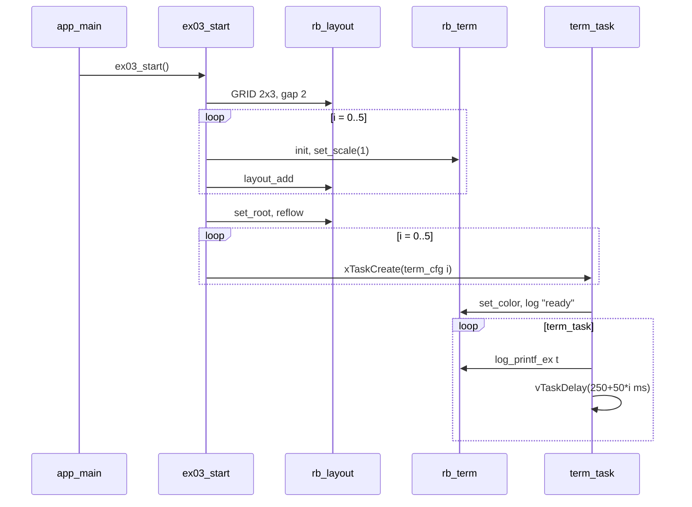

# Demo 03 — Terminal panes and multi-task logging

**Goal.** Mount six `rb_term` scrollback panes in a **3×2** grid and feed each pane from its own FreeRTOS logger task, practicing the same UI tree as earlier demos while learning how robotos serializes LCD draws and formats colored log lines.

## Learning outcomes

1. Place `rb_term` leaves under `rb_layout` and size them with `rb_screen_reflow` (gap **2** px).
2. Use `rb_term_set_scale` and `rb_term_set_color` for pane defaults, then append lines with `rb_term_log_printf_ex` (per-line fg/bg).
3. Run **six independent producers** (tasks) into six panes without corrupting the framebuffer (library display lock).
4. Recognize the term widget’s **ring log** limits (`RB_TERM_LOG_MAX_ROWS` / `RB_TERM_LOG_MAX_COLS`) when designing log volume.
5. Keep the demo in the **Board + UI Features** layer — no `rb_node` or `RSP_*` wire yet.

## Theory — deep detail

### What `rb_term` is

`rb_term` is a **mini terminal pane**: monospace grid inside one layout cell, backed by a fixed-size ring of log lines (each line stores text plus fg/bg RGB565). It is ideal for debug streams, command output, or sensor traces on the LCD.

Typical usage pattern in this lab:

1. `rb_term_init`
2. Optional `rb_term_set_scale(1)` — matches label scale 1 for readable density in a grid
3. After reflow, logging APIs append scrolling text

`rb_term_log_printf_ex(term, fg, bg, fmt, ...)` writes one line with explicit colors (unlike the pane default from `rb_term_set_color`). The demo sets pane default once in the task, then logs each tick with the same fg/bg pair for consistency.

Every draw path documented in the header takes **`bsp_display_lock()`** (recursive mutex on ESP-IDF), which is why multiple tasks can log concurrently.

### UI tree model (screen → layout → leaf)

Grid geometry in code: **`DEMO_ROWS = 2`**, **`DEMO_COLS = 3`** → six panes in two rows of three.

Pipeline:

`rb_display_open` → `rb_screen_init` → `rb_layout_init(..., RB_LAYOUT_GRID, 2, 3, gap 2)` → six × (`rb_term_init`, `rb_term_set_scale`, `rb_layout_add`) → `rb_screen_set_root` → `rb_screen_reflow`.

Each `rb_term_t` is a leaf; the layout divides the screen into equal cells.

### FreeRTOS role

Six **`term_task`** instances (names `tm00`…`tm05`, stack 3072, priority 5):

1. On entry: `rb_term_set_color(term, fg, RB_TERM_BLACK)` and one `rb_term_log_printf_ex(..., "term %u ready", id)`.
2. Loop: log `t%u #n` with the pane’s fg color, increment `n`, delay `250 + i * 50` ms.

Foreground colors cycle through cyan, yellow, green, magenta, red, white (`k_fg[]`). Staggered periods make panes easy to tell apart at a glance.

`ex03_start` idle-loops on 1 s delays after spawning tasks (same pattern as Demo 01/02).

### Styles and API semantics

- **`rb_term_set_color`** — default fg/bg for the pane (cursor region semantics); logging APIs can override per line.
- **`rb_term_log_printf_ex`** — preferred for task logging with explicit colors; scrolls older lines when the ring fills.
- **`rb_style_t`** — term supports `rb_term_set_style` in the API; this demo uses palette constants (`RB_TERM_CYAN`, etc.) instead.

Prefix recap: **`rb_*`** = robotos UI/runtime on MCU; **`bsp_*`** = hardware init only.

## Architecture

```
┌──────────────┐
│   app_main   │
└──────┬───────┘
       ▼
┌──────────────┐
│  ex03_start  │
└──────┬───────┘
       ▼
┌─────────────────────────────────────────────┐
│ rb_layout  GRID  2 rows × 3 cols  gap 2     │
├───────────┬───────────┬───────────┬─────────┤
│ rb_term 0 │ rb_term 1 │ rb_term 2 │  row 0  │
├───────────┼───────────┼───────────┤         │
│ rb_term 3 │ rb_term 4 │ rb_term 5 │  row 1  │
└─────┬─────┴─────┬─────┴─────┬─────┴─────────┘
      ▲           ▲           ▲
      │           │           │
 term_task 0   term_task 1 … term_task 5
 (log_printf_ex loop + vTaskDelay)
```

## Sequence



## APIs this demo uses

| Layer | Calls |
|-------|--------|
| Board | `bsp_init` |
| Display / screen | `rb_display_open`, `rb_screen_init`, `rb_screen_set_root`, `rb_screen_reflow` |
| Layout | `rb_layout_init` (`RB_LAYOUT_GRID`, 2×3, gap 2), `rb_layout_add` |
| Term | `rb_term_init`, `rb_term_set_scale`, `rb_term_set_color`, `rb_term_log_printf_ex` |
| FreeRTOS | `xTaskCreate`, `vTaskDelay`, `pdMS_TO_TICKS` |
| Your demo | `main/main.c` → `ex03_start` |

## Prerequisites

- ESP-IDF (**esp32s3** target)
- **`librobotos_fw.a`** and dev headers ([lib/README.md](../../lib/README.md))
- Board **`ws28p`** or **`es3c28p`**

## Build / flash

```bash
cd demos/demo-labs
.\run 03
```

## Success + checklist

**Success:** Six panes show colored scrolling logs; each prints `term N ready` once, then repeating `tN #counter` lines; update rates differ by pane index.

- [ ] 3×2 grid fills the display
- [ ] Six distinct foreground colors visible
- [ ] Counters increase in every pane
- [ ] No PC bridge required

## device-labs-style enable

In `demos/demo-labs/main/main.c`:

1. `#include "ex03.h"`
2. `ex03_start();` after `bsp_init()`.

Or: `.\run 03` from `demos/demo-labs`. Run `.\rb reconfigure` if needed.

---

**Previous:** [Demo 02 — LED](../ex02-led/README.md) · **Next:** [Demo 04 — Switch](../ex04-switch/README.md)
