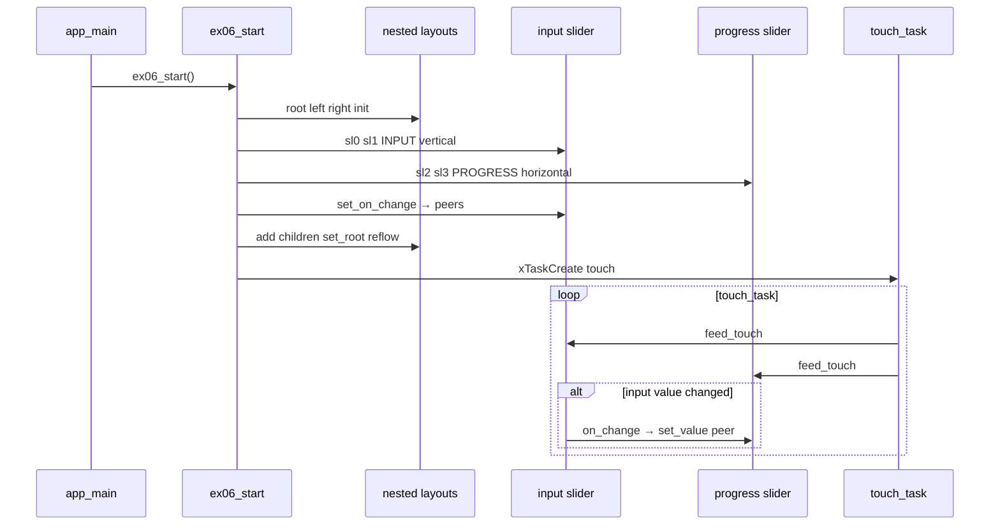

# Demo 06 — Sliders, nested layout, and progress mirrors

**Goal.** Compose **nested layouts** (column split with a row stack on the right), place two vertical **input** sliders and two horizontal **progress** sliders, and wire `on_change` so dragging on the left drives read-only progress bars on the right— mastering `RB_SLIDER_MODE_INPUT` vs `PROGRESS`, orientation, and peer updates via `rb_slider_set_value`.

## Learning outcomes

1. Build a UI tree deeper than a single grid: **`g_root`** → **`g_left`** + **`g_right`** with different `rb_layout_kind_t` values.
2. Configure slider range (0–100), captions, value visibility, and thumb/track styling (`rb_style`, custom thumb RGB).
3. Poll touch into **`rb_slider_feed_touch`** for all four widgets; understand which modes accept drags.
4. Use **`rb_slider_set_on_change`** so user-driven value changes on inputs mirror to progress peers; rely on **`set_value` not firing `on_change`** to avoid feedback loops.
5. Interpret **`RB_SLIDER_MODE_PROGRESS`** as display-only feedback driven by application code.

## Theory — deep detail

### What `rb_slider` is

A flat **slider / progress bar** leaf with horizontal or vertical orientation.

Layout convention (from header):

- **Vertical** — value above rail, label below.
- **Horizontal** — label left and value right on the first row; rail + thumb on the second.

Two modes:

| Mode | Behavior |
|------|----------|
| `RB_SLIDER_MODE_INPUT` | User drags thumb; value changes invoke `on_change` (not when app calls `set_value`). |
| `RB_SLIDER_MODE_PROGRESS` | Shows value; intended as output indicator (still receives touch feed in this demo, but primary motion is programmatic). |

This lab sets `show_value = 1`, `show_fill = 0` on all four, label `"Label"`, range 0–100.

### UI tree model (screen → layout → leaf)

Three layout nodes share one `rb_screen_t`:

1. **`g_root`** — `RB_LAYOUT_COLS`, 1 row × **2** columns, gap **6**
2. **`g_left`** — `RB_LAYOUT_COLS`, 1×2, gap **4** → sliders **0** and **1** (vertical INPUT)
3. **`g_right`** — `RB_LAYOUT_ROWS`, **2**×1, gap **4** → sliders **2** and **3** (horizontal PROGRESS)

Assembly order:

- Configure all four `rb_slider_t` instances
- `rb_layout_add(&g_left, sl[0])`, `sl[1]`; `rb_layout_add(&g_right, sl[2])`, `sl[3]`
- `rb_layout_add(&g_root, &g_left.base)`, `rb_layout_add(&g_root, &g_right.base)`
- `rb_screen_set_root(&g_screen, &g_root.base)` → `rb_screen_reflow`

Nested layouts are still **`rb_layout_t`** widgets; children can be leaves or other layouts.

### Slider pairing in code

| Slider | Orient | Mode | Style / notes | Callback peer |
|--------|--------|------|---------------|---------------|
| 0 | Vertical | INPUT | `RB_STYLE_PRIMARY`, value 35 | drives → **2** |
| 1 | Vertical | INPUT | `RB_STYLE_DANGER`, thumb RGB (232,62,140), value 70 | drives → **3** |
| 2 | Horizontal | PROGRESS | `RB_STYLE_SUCCESS`, value 35 | (target) |
| 3 | Horizontal | PROGRESS | `RB_STYLE_WARNING`, value 70 | (target) |

`on_slider_change` calls `rb_slider_set_value(peer, value)` when the user moves an input slider.

Initial values match so progress bars start aligned with inputs.

### FreeRTOS role

One **`touch_task`** (20 ms period): `bsp_touch_read` → `rb_slider_feed_touch` on all four sliders. Input sliders generate `on_change`; progress sliders update visually when peers receive `set_value`.

No separate animation task.

### Styles and API semantics

- **`rb_slider_set_style`** — semantic palette for track/thumb/text.
- **`rb_slider_set_thumb_rgb`** — override thumb color (slider 1).
- **`rb_slider_set_on_change`** — user drag only; documented as outside display lock.
- **`rb_slider_set_value`** — programmatic update for PROGRESS mirrors; does **not** call `on_change`, preventing loops when input callbacks push to peers.

## Architecture

```
┌──────────────┐
│   app_main   │
└──────┬───────┘
       ▼
┌──────────────┐
│  ex06_start  │
└──────┬───────┘
       ▼
┌─────────────────────────────────────────────────────────────┐
│ rb_root  RB_LAYOUT_COLS  1×2  gap 6                         │
├──────────────────────────────┬──────────────────────────────┤
│ g_left  COLS 1×2  gap 4      │ g_right  ROWS 2×1  gap 4     │
│ ┌──────────┐ ┌──────────┐   │ ┌──────────────────────────┐ │
│ │ sl[0]    │ │ sl[1]    │   │ │ sl[2] H PROGRESS       │ │
│ │ V INPUT  │ │ V INPUT  │   │ ├──────────────────────────┤ │
│ │ PRIMARY  │ │ DANGER   │   │ │ sl[3] H PROGRESS       │ │
│ └────┬─────┘ └────┬─────┘   │ └──────────────────────────┘ │
│      │ on_change  │ on_change│         ▲              ▲      │
│      └──────┬─────┴──────┬───┘         │ set_value    │      │
│             ▼            ▼             │              │      │
│          peer sl[2]   peer sl[3] ─────┘              │      │
└─────────────────────────────────────────────────────────────┘
                              ▲
                       touch_task feed_touch ×4
```

## Sequence



## APIs this demo uses

| Layer | Calls |
|-------|--------|
| Board | `bsp_init`, `bsp_touch_read` |
| Display / screen | `rb_display_open`, `rb_screen_init`, `rb_screen_set_root`, `rb_screen_reflow` |
| Layout | `rb_layout_init` (`RB_LAYOUT_COLS` / `RB_LAYOUT_ROWS`), `rb_layout_add` (nested) |
| Style | `RB_STYLE_PRIMARY`, `SUCCESS`, `DANGER`, `WARNING` |
| Slider | `rb_slider_init`, `rb_slider_set_orient`, `rb_slider_set_mode`, `rb_slider_set_range`, `rb_slider_set_value`, `rb_slider_set_show_value`, `rb_slider_set_show_fill`, `rb_slider_set_label`, `rb_slider_set_style`, `rb_slider_set_thumb_rgb`, `rb_slider_set_on_change`, `rb_slider_feed_touch` |
| FreeRTOS | `xTaskCreate`, `vTaskDelay`, `pdMS_TO_TICKS` |
| Your demo | `main/main.c` → `ex06_start` |

## Prerequisites

- ESP-IDF (**esp32s3**)
- **`librobotos_fw.a`** + headers ([lib/README.md](../../lib/README.md))
- Touch board **`ws28p`** or **`es3c28p`**

## Build / flash

```bash
cd demos/demo-labs
.\run 06
```

## Success + checklist

**Success:** Left column shows two vertical sliders (blue primary ~35%, pink thumb ~70%); right column shows two horizontal progress bars tracking them when you drag the left sliders.

- [ ] Nested layout: left half vs right half visible
- [ ] Dragging top input moves top progress bar
- [ ] Dragging bottom input moves bottom progress bar
- [ ] Values 0–100 shown where enabled
- [ ] No runaway callback loop when syncing peers

## device-labs-style enable

In `demos/demo-labs/main/main.c`:

1. `#include "ex06.h"`
2. `ex06_start();` after `bsp_init()`.

Or: `.\run 06` from `demos/demo-labs`. Run `.\rb reconfigure` if needed.

---

**Previous:** [Demo 05 — Button](../ex05-button/README.md) · **Next:** [Demo 07 — Checkbox](../ex07-checkbox/README.md)
