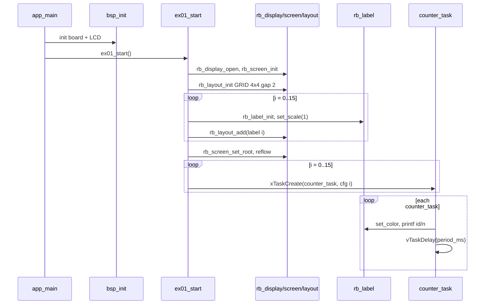

# Demo 01 — Labels in a grid

<div class="ebook-run">

**Track:** `demo-labs` · **Project:** `labs/demo-labs`

```text
rbdev run 01
```

<p class="ebook-source"><strong>Source:</strong> <code>labs/demo-labs/ex01-label/README.md</code></p>

</div>


**Goal.** Open the LCD through robotos UI (`rb_display` / `rb_screen` / `rb_layout`), place sixteen `rb_label` leaves in a 4×4 grid, and drive each cell from its own FreeRTOS task so you see live text updates without a host bridge, `rb_node`, or wire protocol.

## Learning outcomes

1. Explain the UI tree path **display → screen → layout → leaf** and why every leaf embeds `rb_widget_t` as its first member.
2. Build a `RB_LAYOUT_GRID` with explicit rows, columns, and gap, then commit it with `rb_screen_set_root` and `rb_screen_reflow`.
3. Configure label foreground/background colors and monospace scale before the first draw.
4. Use `rb_label_printf` from multiple tasks safely (display lock inside the library) and stagger update rates with `vTaskDelay`.
5. Relate this demo to the workshop layer map: **Board (`bsp_*`) + Features (UI) + your demo** — no runtime spin yet.

## Theory — deep detail

### What `rb_label` is

An `rb_label` is a **read-mostly text leaf**: one layout cell shows a short formatted string on the framebuffer. It is not an input widget; nothing in this lab feeds touch into labels. Colors are RGB565 (`RB_LABEL_*` constants or custom pairs via `rb_label_set_color`). Text is updated with `rb_label_set_text` or `rb_label_printf` (printf-style, bounded buffer inside the widget).

Each label owns geometry indirectly: after `rb_layout_add`, `rb_screen_reflow` assigns `base.rect` in display pixels. Drawing goes through the shared display device; the header documents that leaf redraw paths take the BSP display lock on ESP-IDF.

### UI tree model (screen → layout → leaf)

| Node | Role in this demo |
|------|-------------------|
| `rb_display_t` | Wraps the panel device and framebuffer; opened once with `rb_display_open`. |
| `rb_screen_t` | UI root attached to that display; holds a pointer to the top layout. |
| `rb_layout_t` | Container: here `RB_LAYOUT_GRID`, 4 rows × 4 columns, gap **2** px between cells. |
| `rb_label_t` | Sixteen leaves; each added with `rb_layout_add(&g_layout, &g_labels[i].base)`. |

Static allocation only: `ex01.c` keeps `g_disp`, `g_screen`, `g_layout`, and `g_labels[16]` in file scope. No heap UI tree.

Boot order matches every widget demo in 01–09:

`bsp_init` → `rb_display_open` → `rb_screen_init` → `rb_layout_init` → init/configure leaves → `rb_layout_add` (each) → `rb_screen_set_root` → `rb_screen_reflow`.

### FreeRTOS role

After the tree is on screen, the demo creates **sixteen** tasks (`counter_task`), one per label. Each task loops forever:

1. `rb_label_set_color` (fg from a fixed palette table, bg `RB_LABEL_BLACK`).
2. `rb_label_printf(label, "%u %" PRIu32, id, n)` — cell index and a monotonic counter.
3. `vTaskDelay(pdMS_TO_TICKS(period_ms))` where `period_ms = 200 + i * 40` (staggered cadence).

Task stack **3072** bytes, priority **5**, names `c00`…`c15`. `ex01_start` itself ends in a idle `vTaskDelay(1000)` loop so `app_main` never returns while the lab runs.

There is **no** `rb_spin_once` and no serial wire — pure local UI refresh.

### Styles and API semantics

- `rb_label_init` zeroes the struct and sets safe defaults.
- `rb_label_set_scale(&label, 1)` selects the bitmap font scale used in the grid (all cells use scale 1).
- `rb_label_set_color` sets fg/bg for the next redraw; calling it every tick keeps colors stable if you later animate them.
- `rb_label_printf` formats into the label buffer and triggers redraw; safe to call from tasks because the implementation serializes framebuffer access.

Prefix **`rb_*`** means robotos Feature/runtime API on the MCU (see [NAMING.md](../../NAMING.md)); **`bsp_*`** is board support only (`bsp_init` from `main`).

## Architecture

```
┌──────────────┐
│   app_main   │
└──────┬───────┘
       │ bsp_init()
       ▼
┌──────────────┐     open/init/reflow
│  ex01_start  │──────────────────────────────────────────┐
└──────┬───────┘                                          │
       │                                                  ▼
       │                                    ┌─────────────────────────┐
       │                                    │ rb_display_t  g_disp    │
       │                                    └───────────┬─────────────┘
       │                                                │
       │                                    ┌───────────▼─────────────┐
       │                                    │ rb_screen_t  g_screen   │
       │                                    └───────────┬─────────────┘
       │                                                │ set_root
       │                                    ┌───────────▼─────────────┐
       │                                    │ rb_layout_t  GRID 4×4   │
       │                                    │ gap 2                   │
       │                                    └───────────┬─────────────┘
       │                          ┌─────────────────────┼─────────────────────┐
       │                          ▼                     ▼                     ▼
       │                   rb_label[0]            rb_label[1]   …   rb_label[15]
       │                          ▲                     ▲                     ▲
       │                          │                     │                     │
       └──────────────────────────┴─────────────────────┴─────────────────────┘
                    xTaskCreate(counter_task) × 16  (priority 5, 3072 stack)
```

## Sequence



## APIs this demo uses

| Layer | Calls |
|-------|--------|
| Board | `bsp_init` |
| Display / screen | `rb_display_open`, `rb_screen_init`, `rb_screen_set_root`, `rb_screen_reflow` |
| Layout | `rb_layout_init` (`RB_LAYOUT_GRID`, rows 4, cols 4, gap 2), `rb_layout_add` |
| Label | `rb_label_init`, `rb_label_set_scale`, `rb_label_set_color`, `rb_label_printf` |
| FreeRTOS | `xTaskCreate`, `vTaskDelay`, `pdMS_TO_TICKS` |
| Your demo | `main/main.c` → `ex01_start` |

## Prerequisites

- ESP-IDF (same major as class notes); target **esp32s3**
- Prebuilt **`librobotos_fw.a`** and headers under `include/firmware-esp32-s3-dev/` at the workshop root ([lib/README.md](../../lib/README.md))
- Board SKU **`ws28p`** (default) or **`es3c28p`** via `-DBOARD=` / `rbdev config --board es3c28p` ([ports/boards/README.md](../../ports/boards/README.md))

## Build / flash

```bash
cd labs/demo-labs
rbdev run 01
# Ternion board: rbdev config --board es3c28p then rbdev run 01
```

Optional monitor: `rbdev run 01 --monitor`

## Success + checklist

**Success:** Sixteen labels in a 4×4 grid show `id counter` (e.g. `3 42`) in distinct colors; each cell’s counter advances at a different speed (200 ms + 40 ms × index). No PC bridge required.

- [ ] Flash completes without link errors against `librobotos_fw.a`
- [ ] Full grid visible after boot (no blank screen)
- [ ] All sixteen indices 0–15 appear somewhere on screen
- [ ] Counters increase over time; faster cells are higher-indexed (roughly)
- [ ] No touch interaction expected (display-only labels)

## device-labs-style enable

In `labs/demo-labs/main/main.c`:

1. `#include "ex01.h"`
2. Call `ex01_start();` inside `app_main` after `bsp_init()`.

Or from `labs/demo-labs`: `rbdev run 01` (rewrites `main/main.c` to select this lab). Run `rbdev reconfigure` if you added the folder recently.

---

**Previous:** none · **Next:** [Demo 02 — LED](../ex02-led/README.md)
