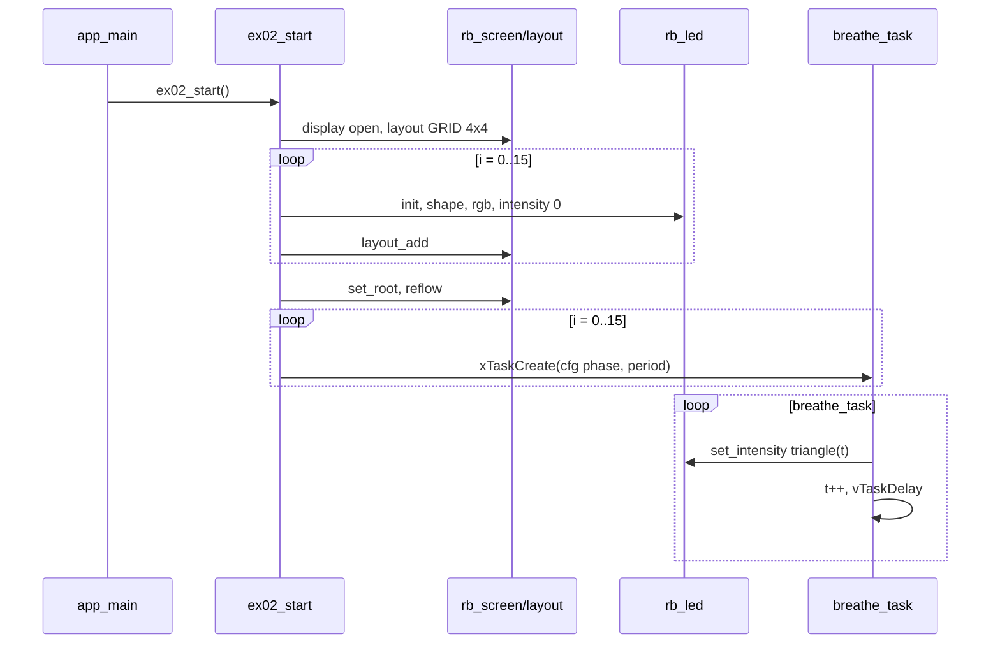

# Demo 02 — LED indicators with breathe animation

<div class="ebook-run">

**Track:** `demo-labs` · **Project:** `labs/demo-labs`

```text
rbdev run 02
```

<p class="ebook-source"><strong>Source:</strong> <code>labs/demo-labs/ex02-led/README.md</code></p>

</div>


**Goal.** Fill a 4×4 grid with `rb_led` leaves—alternating circle and round-rect shapes—and animate each cell’s **intensity** (0–255) with a triangle wave so you learn display-only indicators, RGB tinting, and multi-task refresh without touching `bsp_led_*` or the wire stack.

## Learning outcomes

1. Describe `rb_led` as a **framed lens + glow** leaf driven by RGB and intensity, not as on-board GPIO (hardware binding stays in the app if needed).
2. Compose the same **screen → layout → leaf** tree as Demo 01, swapping labels for LEDs.
3. Choose `RB_LED_SHAPE_CIRCLE` vs `RB_LED_SHAPE_ROUND_RECT` per cell and set per-LED RGB from a palette table.
4. Implement smooth brightness motion with `rb_led_set_intensity` from a dedicated FreeRTOS task per LED.
5. Phase-shift multiple breathe loops so the grid feels organic rather than synchronized.

## Theory — deep detail

### What `rb_led` is

`rb_led` is a **display-only status lamp**: a colored lens (optional frame ring and body colors) whose brightness is `intensity` 0…255. The header states explicitly that it does **not** call `bsp_led_*`; workshop boards may still have a physical LED, but this widget paints on the LCD only.

Visual state is:

- **Shape** — circle or rounded rectangle (`rb_led_set_shape`).
- **Color** — `rb_led_set_rgb(r,g,b)` for the lit lens; optional frame/body RGB APIs exist for richer chrome.
- **Brightness** — `rb_led_set_intensity`; 0 reads as off, 255 as full glow.

Styles via `rb_led_set_style` are available in the API; this demo sets raw RGB per index instead.

### UI tree model (screen → layout → leaf)

Identical scaffolding to Demo 01:

`rb_display_open` → `rb_screen_init` → `rb_layout_init(..., RB_LAYOUT_GRID, 4, 4, gap 2)` → for each LED: `rb_led_init`, configure shape/RGB/intensity, `rb_layout_add` → `rb_screen_set_root` → `rb_screen_reflow`.

Sixteen `rb_led_t` instances live in `g_leds[]`. Each embeds `rb_widget_t base` first so the layout can treat them as generic children.

### FreeRTOS role

Sixteen **`breathe_task`** instances run in parallel. Each maintains a local phase byte `t` that increments every period:

- Triangle wave: if `t < 128`, `intens = t * 2`; else `intens = (255 - t) * 2`.
- `rb_led_set_intensity(led, intens)` then `vTaskDelay(period_ms)`.

Per-LED configuration:

- **Initial phase** `i * 16` (desynchronizes neighbors).
- **Period** `20 + (i % 4) * 4` ms (slightly different speeds within columns).

Tasks use 3072-byte stacks, priority 5, names `led00`…`led15`. Shape alternates by index: even → circle, odd → round-rect.

### Styles and API semantics

- `rb_led_init` must precede other setters; `ok` flag gates redraw.
- `rb_led_set_intensity` triggers a redraw path that respects display locking (same family as other leaves).
- Geometry (`base.rect`) is valid only after `rb_screen_reflow`; breathe tasks only change intensity, not layout.

No touch, no callbacks — pure animation.

## Architecture

```
┌──────────────┐
│   app_main   │
└──────┬───────┘
       │ bsp_init()
       ▼
┌──────────────┐
│  ex02_start  │
└──────┬───────┘
       │
       ▼
┌──────────────────────────────────────────────────────────────┐
│ rb_screen  ──►  rb_layout GRID 4×4  gap 2                    │
└───────────────────────────────┬──────────────────────────────┘
                                │
        ┌───────────────────────┼───────────────────────┐
        ▼                       ▼                       ▼
   rb_led circle            rb_led round-rect      … ×16
   RGB + intensity 0        RGB + intensity 0
        ▲                       ▲
        │                       │
        └───────────┬───────────┘
                    │
            breathe_task ×16
            (triangle 0..255..0)
```

## Sequence



## APIs this demo uses

| Layer | Calls |
|-------|--------|
| Board | `bsp_init` |
| Display / screen | `rb_display_open`, `rb_screen_init`, `rb_screen_set_root`, `rb_screen_reflow` |
| Layout | `rb_layout_init` (`RB_LAYOUT_GRID`, 4×4, gap 2), `rb_layout_add` |
| LED | `rb_led_init`, `rb_led_set_shape`, `rb_led_set_rgb`, `rb_led_set_intensity` |
| FreeRTOS | `xTaskCreate`, `vTaskDelay`, `pdMS_TO_TICKS` |
| Your demo | `main/main.c` → `ex02_start` |

## Prerequisites

- ESP-IDF for **esp32s3**
- **`librobotos_fw.a`** + `include/firmware-esp32-s3-dev/` ([lib/README.md](../../lib/README.md))
- Board **`ws28p`** or **`es3c28p`** ([ports/boards/README.md](../../ports/boards/README.md))

## Build / flash

```bash
cd labs/demo-labs
rbdev run 02
```

## Success + checklist

**Success:** Sixteen colored “lamp” widgets in a 4×4 grid breathe continuously; neighbors are out of phase; even indices look circular, odd indices rounded-rectangle.

- [ ] All cells animate (none stuck at black)
- [ ] Visible shape alternation left-to-right in each row
- [ ] No host serial bridge required
- [ ] Build links against prebuilt robotos firmware library

## device-labs-style enable

In `labs/demo-labs/main/main.c`:

1. `#include "ex02.h"`
2. `ex02_start();` after `bsp_init()`.

Or: `rbdev run 02` from `labs/demo-labs`. Run `rbdev reconfigure` if needed.

---

**Previous:** [Demo 01 — Label](../ex01-label/README.md) · **Next:** [Demo 03 — Term](../ex03-term/README.md)
