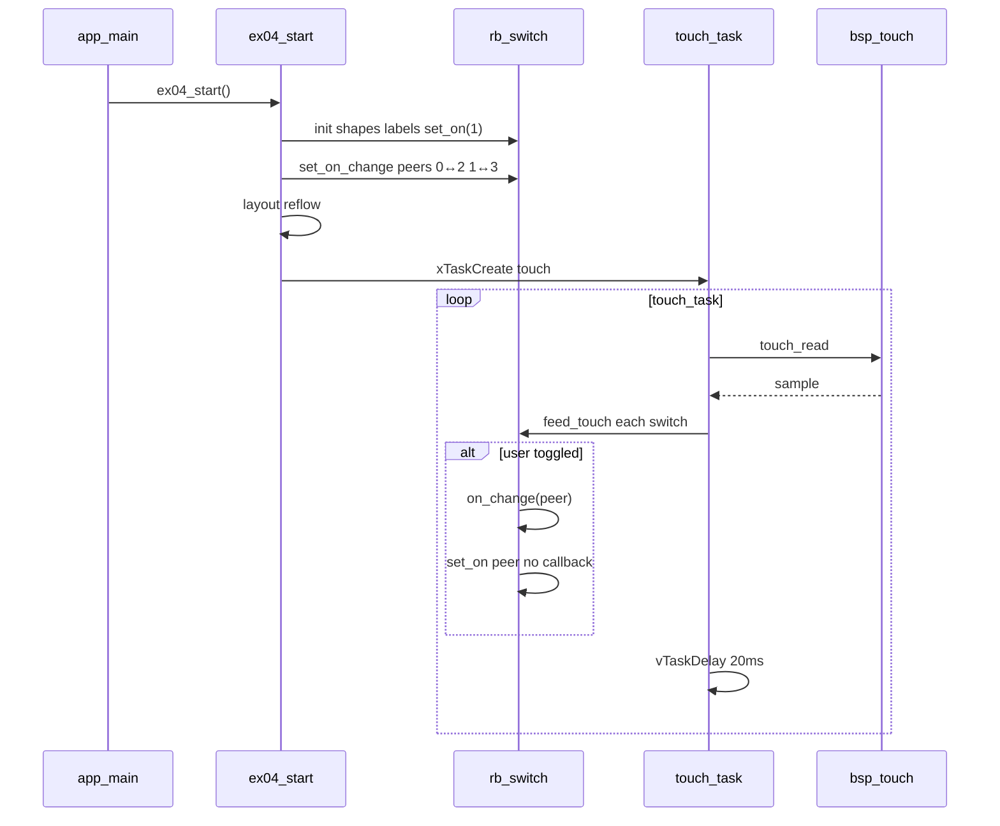

# Demo 04 — Switches, touch, and paired state

<div class="ebook-run">

**Track:** `demo-labs` · **Project:** `labs/demo-labs`

```text
rbdev run 04
```

<p class="ebook-source"><strong>Source:</strong> <code>labs/demo-labs/ex04-switch/README.md</code></p>

</div>


**Goal.** Build a **2×2** collage of `rb_switch` widgets (pill vs round-rect, custom YES/NO labels on the top row), drive them from a polled touch task, and mirror ON/OFF state between **vertical pairs** using `on_change` callbacks—learning input leaves, hit testing, and the rule that programmatic `set_on` does not re-fire callbacks.

## Learning outcomes

1. Configure switch **shape** (`RB_SWITCH_SHAPE_PILL` / `ROUND_RECT`) and **labels** (`rb_switch_set_labels`).
2. Poll `bsp_touch_read` and fan samples into `rb_switch_feed_touch` for every switch in a 20 ms loop.
3. Wire `rb_switch_set_on_change` to sync a “peer” switch when the user toggles (not when code calls `rb_switch_set_on`).
4. Explain why reciprocal peer bindings (0↔2, 1↔3) keep two rows aligned without callback storms.
5. Relate touch sampling to layout cell geometry (`base.rect` hit tests the full cell).

## Theory — deep detail

### What `rb_switch` is

A flat **slide switch** leaf: colored track, ON/OFF caption, white knob with grip lines. State is a boolean `on` updated by:

- **`rb_switch_set_on(sw, on)`** — application sets state (initial values, remote sync); **does not** invoke `on_change`.
- **`rb_switch_feed_touch(sw, &sample)`** — hit-tests the layout cell; on a rising-edge press inside the rect, toggles and may call **`on_change(sw, on, user)`** outside the display lock.

Shapes: capsule **pill** or **round-rect** track. Labels default to `"ON"` / `"OFF"` but this demo sets `"YES"` / `"NO"` on indices 0 and 1 only; bottom row uses defaults.

### UI tree model (screen → layout → leaf)

`rb_layout_init(..., RB_LAYOUT_GRID, 2, 2, gap **4**)` — slightly larger gap than label/LED demos for easier tapping.

Four switches configured before `rb_layout_add`:

| Index | Shape | Labels | Initial ON |
|-------|-------|--------|------------|
| 0 | Pill | YES / NO | 1 |
| 1 | Round-rect | YES / NO | 1 |
| 2 | Pill | ON / OFF (default) | 1 |
| 3 | Round-rect | ON / OFF (default) | 1 |

Then `rb_screen_set_root` + `rb_screen_reflow`.

### FreeRTOS role

One **`touch_task`** (3072 stack, priority 5):

- Every 20 ms: if `bsp_touch_read(&smp) == 0`, call `rb_switch_feed_touch` on all four switches.
- Fan-out ensures whichever cell contains the contact receives the sample; others no-op.

No animation tasks — interaction-only demo. `ex04_start` sleeps in 1 s `vTaskDelay` after creating touch task.

### Callback pairing semantics

`on_switch_change` ignores its `sw` argument and calls `rb_switch_set_on(peer, on)` when `user` holds the peer pointer.

Bindings (comment in source: top ↔ bottom column peers):

- `g_sw[0]` ↔ `g_sw[2]`
- `g_sw[1]` ↔ `g_sw[3]`

Because **`set_on` does not re-fire `on_change`**, toggling the top switch updates the bottom visually without infinite recursion. User touch on either row still toggles locally first, then the callback aligns the partner.

### Styles

`rb_switch_set_style` exists for semantic palettes (`RB_STYLE_PRIMARY`, …); this collage uses widget defaults after `rb_switch_init`. RGB track/knob overrides are available via `rb_switch_set_on_rgb`, etc., but unused here.

## Architecture

```
┌──────────────┐
│   app_main   │
└──────┬───────┘
       ▼
┌──────────────┐
│  ex04_start  │
└──────┬───────┘
       ▼
┌─────────────────────────────────────┐
│ rb_layout  GRID 2×2  gap 4          │
├─────────────────┬───────────────────┤
│ sw[0] pill      │ sw[1] round-rect  │  row 0  YES/NO
│ YES/NO          │ YES/NO            │
├─────────────────┼───────────────────┤
│ sw[2] pill      │ sw[3] round-rect  │  row 1  ON/OFF
│ ON/OFF          │ ON/OFF            │
└────────┬────────┴────────┬──────────┘
         │ on_change       │ on_change
         └────── pair ─────┘   (0↔2, 1↔3)

┌──────────────┐
│  touch_task  │──► bsp_touch_read ──► feed_touch ×4  (20 ms)
└──────────────┘
```

## Sequence



## APIs this demo uses

| Layer | Calls |
|-------|--------|
| Board | `bsp_init`, `bsp_touch_read` |
| Display / screen | `rb_display_open`, `rb_screen_init`, `rb_screen_set_root`, `rb_screen_reflow` |
| Layout | `rb_layout_init` (`RB_LAYOUT_GRID`, 2×2, gap 4), `rb_layout_add` |
| Switch | `rb_switch_init`, `rb_switch_set_shape`, `rb_switch_set_labels`, `rb_switch_set_on`, `rb_switch_set_on_change`, `rb_switch_feed_touch` |
| FreeRTOS | `xTaskCreate`, `vTaskDelay`, `pdMS_TO_TICKS` |
| Your demo | `main/main.c` → `ex04_start` |

## Prerequisites

- ESP-IDF (**esp32s3**)
- **`librobotos_fw.a`** + headers ([lib/README.md](../../lib/README.md))
- Touch-capable board **`ws28p`** or **`es3c28p`**

## Build / flash

```bash
cd labs/demo-labs
rbdev run 04
```

## Success + checklist

**Success:** Four switches visible; tapping toggles knob/track; top-row YES/NO switches stay aligned with bottom-row partners in the same column.

- [ ] Top row shows YES/NO captions; bottom row ON/OFF
- [ ] Pill vs round-rect visible in each row
- [ ] Toggling index 0 or 2 keeps both in sync (same for 1 and 3)
- [ ] Programmatic sync does not cause flicker loops

## device-labs-style enable

In `labs/demo-labs/main/main.c`:

1. `#include "ex04.h"`
2. `ex04_start();` after `bsp_init()`.

Or: `rbdev run 04` from `labs/demo-labs`. Run `rbdev reconfigure` if needed.

---

**Previous:** [Demo 03 — Term](../ex03-term/README.md) · **Next:** [Demo 05 — Button](../ex05-button/README.md)
