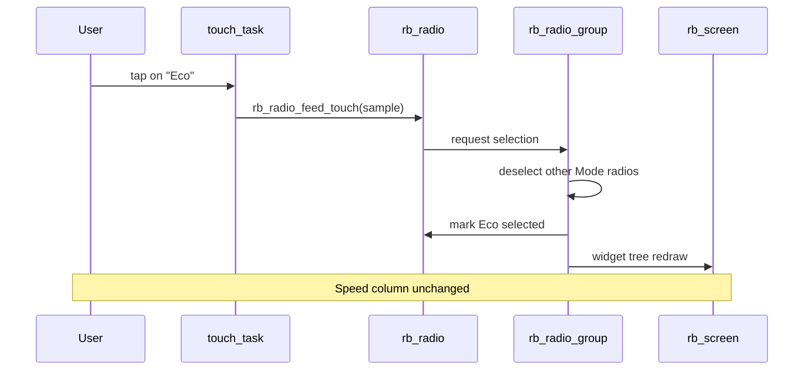

# Demo 08 — Dual exclusive radio groups

<div class="ebook-run">

**Track:** `demo-labs` · **Project:** `labs/demo-labs`

```text
rbdev run 08
```

<p class="ebook-source"><strong>Source:</strong> <code>labs/demo-labs/ex08-radio/README.md</code></p>

</div>


**Goal.** Present **two independent single-choice lists** side by side on one screen: **Mode** (Auto, Manual, Eco, Sport) on the left and **Speed** (Slow, Med, Fast, Max) on the right. Each list is an **`rb_radio_group`** — exactly one **`rb_radio`** selected at a time within the group, with no coupling between groups. UI-only: no wire, no host.

## Learning outcomes

1. Nest layouts: root **`RB_LAYOUT_COLS`** holding two child **`RB_LAYOUT_ROWS`** panes.
2. Create **`rb_radio_group_init`**, **`rb_radio_group_add`**, and **`rb_radio_group_select`** for exclusive selection.
3. Style each option with a distinct **`rb_radio_set_style`** row (Primary → Danger).
4. Optionally observe **`rb_radio_group_set_on_change`** (this demo leaves the handler empty — exclusivity is enforced by the group, not app logic).
5. Poll touch and dispatch **`rb_radio_feed_touch`** across all eight radios.

## Theory — deep detail

**Radio vs checkbox.** A radio button represents one choice from a **set**. When you select option B, option A must deselect automatically. The **`rb_radio_group_t`** object owns that invariant: you register member radios with **`rb_radio_group_add`**, and **`rb_radio_group_select`** marks one member active and clears the others. Two groups on one screen mean **two independent sets** — selecting **Sport** does not change **Speed**, and vice versa.

**Layout geometry.** `ex08_start` builds:

- **`g_root`**: one row, two columns (gutter `6`) — splits the screen vertically.
- **`g_left` / `g_right`**: each **`RB_LAYOUT_ROWS`** with `DEMO_ROWS` (4) slots and gutter `4`.

Radios `0…3` live in **Mode**; indices `4…7` in **Speed**, each index `i` sharing **`k_styles[i % 4]`** and its label from **`k_mode`** or **`k_speed`**.

**Default selection.** After reflow, the firmware calls **`rb_radio_group_select(&g_mode, &g_rad[0])`** (**Auto**) and **`rb_radio_group_select(&g_speed, &g_rad[DEMO_ROWS + 1])`** (**Med**, the second speed option). Learners should verify the filled indicator on boot matches those labels.

**Change notifications.** `on_group_change` is registered on both groups but intentionally does nothing except document that **visual exclusivity** is enough for this lab; a product firmware might log the choice or push a **`ParamEvent`** here in later exercises.

**Touch.** Same **`touch_task`** pattern as Demo 07 (20 ms, priority 5): one sample, eight **`rb_radio_feed_touch`** calls. The group resolves which radio becomes selected when a hit occurs.

## Architecture

```
┌────────────────────── app_main ──────────────────────┐
│  bsp_init()  →  ex08_start()                         │
└──────────────────────────┬───────────────────────────┘
                           │
         ┌─────────────────▼─────────────────┐
         │  rb_screen                        │
         │  g_root (COLS 1×2)                │
         │    ├─ g_left  (ROWS×1) Mode grp   │
         │    │     4 × rb_radio             │
         │    └─ g_right (ROWS×1) Speed grp  │
         │          4 × rb_radio             │
         └─────────────────┬─────────────────┘
                           │
         ┌─────────────────▼─────────────────┐
         │  touch_task @ 20 ms               │
         │  feed_touch on all 8 radios       │
         └─────────────────────────────────────┘
```

## Sequence



## APIs this demo uses

| Layer | You will call |
|-------|----------------|
| Board | `bsp_init`, `bsp_touch_read` |
| UI tree | `rb_display_open`, `rb_screen_init`, `rb_layout_init`, `rb_layout_add`, `rb_screen_set_root`, `rb_screen_reflow` |
| Style | `rb_radio_set_style` with `RB_STYLE_*` |
| Radio | `rb_radio_init`, `rb_radio_set_label`, `rb_radio_feed_touch` |
| Radio group | `rb_radio_group_init`, `rb_radio_group_add`, `rb_radio_group_select`, `rb_radio_group_set_on_change` |
| RTOS | `xTaskCreate`, `vTaskDelay` |

## Prerequisites

- Same toolchain and **`librobotos_fw.a`** setup as other demo-labs
- [Demo 07 — Checkbox](../ex07-checkbox/README.md) (grid + touch task)
- Familiarity with **`RB_LAYOUT_COLS`** / **`RB_LAYOUT_ROWS`** from earlier UI demos

## Build / flash

```bash
cd labs/demo-labs
rbdev run 08
# Ternion: rbdev config --board es3c28p then rbdev run 08
```

## Success + checklist

- [ ] Left column shows four **Mode** labels; right column four **Speed** labels.
- [ ] Exactly **one** filled radio per column at all times.
- [ ] Boot defaults: **Auto** (Mode) and **Med** (Speed) selected.
- [ ] Tapping another row in the same column moves selection; the other column is unaffected.
- [ ] No host bridge required.

## device-labs-style enable

In `labs/demo-labs/main/main.c`:

1. `#include "ex08.h"`
2. `ex08_start();`

Or: `rbdev run 08` from `labs/demo-labs` (rewrites `main/main.c`). Run `rbdev reconfigure` if you just added this folder.

## Previous / Next

- **Previous:** [Demo 07 — Checkbox](../ex07-checkbox/README.md)
- **Next:** [Demo 09 — Settings form](../ex09-form/README.md)
