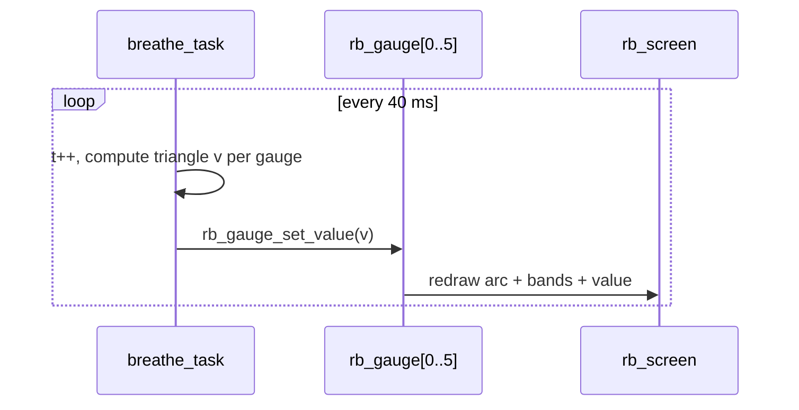

# Demo 11 — Gauge grid with warn/danger bands

<div class="ebook-run">

**Track:** `demo-labs` · **Project:** `labs/demo-labs`

```text
rbdev run 11
```

<p class="ebook-source"><strong>Source:</strong> <code>labs/demo-labs/ex11-gauge/README.md</code></p>

</div>


**Goal.** Show **six animated gauges** in a **`2×3`** grid, each with its own **style**, **unit**, **label**, and **threshold bands** (warning/danger fills). A **`breathe_task`** drives values in a smooth triangle wave with per-gauge phase offset. **No wire** — pure UI after the serial lesson in Demo 10.

## Learning outcomes

1. Initialize **`rb_gauge`** widgets and place them in **`RB_LAYOUT_GRID`** (`2×3`, gutter `6`).
2. Configure range **0–100**, numeric readout, **unit** string, and **label** per cell.
3. Set **band thresholds** with **`rb_gauge_set_bands(gauge, 70, 90)`** for warn/danger arc fills.
4. Update values from a FreeRTOS task without touch input (**`rb_gauge_set_value`** every **40 ms**).
5. Relate on-screen motion to future sensor topics (Demo 13+) without subscribing yet.

## Theory — deep detail

**Gauge semantics.** A gauge maps a scalar **`value`** into an arc or bar between **`min`** and **`max`**. This demo fixes **`0…100`** for every cell so comparisons are easy. **`rb_gauge_set_show_value(1)`** draws the number; **`rb_gauge_set_unit`** appends engineering context (**mV**, **mm**, **Hz**, **%**, **°C**, **rpm**).

**Bands.** **`rb_gauge_set_bands(&g, 70, 90)`** declares soft limits: typical green/normal below **70**, caution between **70–90**, danger at/above **90** (exact drawing is implemented in **`librobotos_fw.a`**). Learners use this lab to preview how telemetry might look when IMU/battery labs feed real data later.

**Breathe animation.** Task **`breathe_task`** maintains global phase **`t`**. For each gauge **`i`**, effective phase **`p = (t + k_phase[i]) % 200`** with stagger **`k_phase`** = `{0, 20, …, 100}`. Triangle wave:

- if **`p < 100`** → **`v = p`**
- else **`v = 200 - p`**

So each gauge oscillates **0→100→0** over **200×40 ms ≈ 8 s**, desynchronized for a live dashboard feel.

**Styles and labels.** Six entries cycle **`RB_STYLE_PRIMARY`** through **`RB_STYLE_SECONDARY`**. Labels (**Batt**, **Lift**, **Fan**, **CPU**, **Temp**, **Motor**) are fictional channels — no ADC task reads them here.

**Contrast with Demo 10.** No **`rb_node`**, **`rb_publish`**, or host tool. If you still have serial-bridge open, you may see idle transport noise from other projects; this firmware does not init the node.

## Architecture

```
┌────────────────────── app_main ──────────────────────┐
│  bsp_init()  →  ex11_start()                         │
└──────────────────────────┬───────────────────────────┘
                           │
         ┌─────────────────▼─────────────────┐
         │  rb_screen + GRID layout 2×3      │
         │    6 × rb_gauge                   │
         │      style / label / unit         │
         │      bands 70 / 90                │
         └─────────────────┬─────────────────┘
                           │
         ┌─────────────────▼─────────────────┐
         │  breathe_task @ 40 ms             │
         │  rb_gauge_set_value (triangle)    │
         └─────────────────────────────────────┘
```

## Sequence



## APIs this demo uses

| Layer | You will call |
|-------|----------------|
| Board | `bsp_init` |
| UI tree | `rb_display_open`, `rb_screen_init`, `rb_layout_init`, `rb_layout_add`, `rb_screen_set_root`, `rb_screen_reflow` |
| Style | `rb_gauge_set_style` with `RB_STYLE_*` |
| Gauge | `rb_gauge_init`, `rb_gauge_set_range`, `rb_gauge_set_show_value`, `rb_gauge_set_unit`, `rb_gauge_set_label`, `rb_gauge_set_bands`, `rb_gauge_set_value` |
| RTOS | `xTaskCreate`, `vTaskDelay` |

## Prerequisites

- [Demo 10 — Log / wire](../ex10-log/README.md) (understand what this lab intentionally skips)
- ESP-IDF + **`librobotos_fw.a`** as in other demo-labs

## Build / flash

```bash
cd labs/demo-labs
rbdev run 11
# Ternion: rbdev config --board es3c28p then rbdev run 11
```

## Success + checklist

- [ ] **2×3** gauges visible with distinct colors and labels/units.
- [ ] Values animate smoothly; peaks near **100** show warn/danger band coloring.
- [ ] Gauges stay out of phase (not all identical).
- [ ] No touch required; no host serial-bridge required.

## device-labs-style enable

In `labs/demo-labs/main/main.c`:

1. `#include "ex11.h"`
2. `ex11_start();`

Or: `rbdev run 11` from `labs/demo-labs` (rewrites `main/main.c`). Run `rbdev reconfigure` if you just added this folder.

## Previous / Next

- **Previous:** [Demo 10 — Log / wire](../ex10-log/README.md)
- **Next:** [Demo 12 — Params](../ex12-param/README.md)
