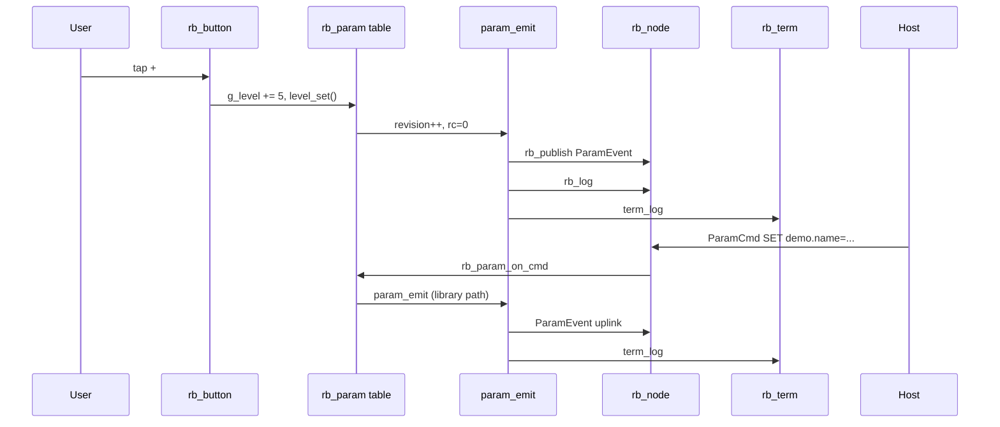

# Demo 12 — Runtime parameter table and ParamCmd

<div class="ebook-run">

**Track:** `demo-labs` · **Project:** `labs/demo-labs`

```text
rbdev run 12
```

<p class="ebook-source"><strong>Source:</strong> <code>labs/demo-labs/ex12-param/README.md</code></p>

</div>


**Goal.** Expose a tiny **parameter table** (`demo.level`, `demo.name`) through **`rb_param_*`**, answer host **`ParamCmd`** on **`RSP_MSG_CMD_PARAM` (0x8a)**, and uplink **`ParamEvent`** on **`RSP_MSG_PARAM_EVENT` (0x29)**. Local **−** / **+** buttons adjust **`demo.level`** so the lab works without a host. Combines **`rb_term`**, touch, **`rb_node`**, and wire encoding via **`serial_proto`**.

## Learning outcomes

1. Define **`rb_param_t`** rows with **`get`/`set`** callbacks and text types (**`i64`**, **`str`**).
2. Call **`rb_param_init`**, register **`rb_sub_init(..., RSP_MSG_CMD_PARAM, rb_param_on_cmd, …)`**, and **`rb_param_restore`** at boot.
3. Implement an **`param_emit`** callback that **nanopb-encodes** **`robotos_serial_v1_ParamEvent`** and **`rb_publish`** on **`g_param_ev_pub`**.
4. Mirror param activity with **`rb_log`** and **`rb_term_println`** (same pattern as Demo 10).
5. Drive **local UI** so **`on_btn`** applies the same validation path as a host SET ( **`level_set`**, revision bump, **`param_emit`**).

## Theory — deep detail

**Table-driven params.** Instead of hard-coding one-off command parsers, robotos keeps a **`rb_param_t[]`** table. Each entry has:

| Field | Demo 12 usage |
|-------|----------------|
| `name` | `"demo.level"`, `"demo.name"` |
| `type` | `"i64"` / `"str"` (wire metadata) |
| `nvs` / `persist` | **`NULL` / 0** — RAM-only; **`rb_param_restore`** has nothing to load |
| `get` / `set` | Copy to/from **`g_level`** (0–100) or **`g_name[24]`** |
| `revision` | Incremented on local **+** / **−**; host SET via library also bumps revision |

**Validation.**

- **`level_set`**: `strtol`; reject **`x < 0`** or **`x > 100`** with **`-22`** (EINVAL-style).
- **`name_set`**: reject empty, NULL, or length ≥ buffer.

**Wire flow.** Host sends **ParamCmd** frames → **`rb_param_on_cmd`** (in firmware library) parses op (GET/SET/LIST/…) → calls your **`get`/`set`** → invokes **`param_emit`** for each result. **`param_emit`** fills **`ParamEvent`**: name, value, type, **`rc`**, **`revision`**, then **`sp_encode`** + **`rb_publish(..., RSP_MSG_PARAM_EVENT)`**.

**Local buttons.** **`on_btn`** receives **`user`** as **`±5`**. On **`RB_BUTTON_EV_CLICK`**: clamp **`g_level`**, format decimal string, call **`level_set`**, **`g_params[0].revision++`**, **`param_emit(..., rc=0)`**. That deliberately reuses the SET path so LCD, log, and uplink match a host write.

**Node setup.** Same skeleton as Demo 10: **`rb_transport_serial_init`**, node name **`demo12`**, **`heartbeat_ms = 1000`**, **`rb_cmd_bind_log`**, **`spin_task`** with **`rb_spin_once`** + **`rb_cmd_poll`**. Extra subscriber: **`RSP_MSG_CMD_REBOOT` → `rb_cmd_reboot`**. No LED or timesync subs in this file.

**UI layout.** **`g_root`**: term on top, **`g_btns`** row (**−** secondary, **+** primary). **`touch_task`** feeds both buttons at 20 ms.

**Host tools.** Use **serial-bridge** (or class tooling) to issue **ParamCmd** GET/SET/LIST against **`demo.level`** and **`demo.name`**. Raw **`idf.py monitor`** is fine for reading **`term_log`** lines like **`demo.level=42 rc=0`**, not for structured decode.

## Architecture

```
┌────────────────────── app_main ──────────────────────┐
│  bsp_init()  →  ex12_start()                         │
└──────────────────────────┬───────────────────────────┘
                           │
    ┌──────────────────────┼──────────────────────┐
    │                      │                      │
    ▼                      ▼                      ▼
┌─────────┐        ┌───────────────┐      ┌──────────────┐
│ rb_term │        │ rb_param table│      │ touch_task   │
│ + −/+   │        │ demo.level    │      │ feed buttons │
└────▲────┘        │ demo.name     │      └──────────────┘
     │              └───────┬───────┘
     │ param_emit          │ get/set
     │              ┌───────▼───────┐
     └──────────────│ rb_node       │
                    │ demo12        │
                    │ sub PARAM     │
                    │ pub PARAM_EV  │
                    └───────┬───────┘
                            │
                    ┌───────▼───────┐
                    │ spin_task     │
                    └───────┬───────┘
                            │
                    ┌───────▼───────┐
                    │ Host ParamCmd │
                    │ serial-bridge │
                    └───────────────┘
```

## Sequence



## APIs this demo uses

| Layer | You will call |
|-------|----------------|
| Board | `bsp_init`, `bsp_touch_read` |
| UI | `rb_term_*`, `rb_button_*`, `rb_screen_*`, `rb_layout_*` |
| Param | `rb_param_init`, `rb_param_on_cmd`, `rb_param_restore`, `rb_param_t` |
| Transport / node | `rb_transport_serial_init`, `rb_node_init`, `rb_spin_once`, `rb_log`, `rb_cmd_bind_log`, `rb_cmd_poll` |
| Pub/sub | `rb_pub_init`, `rb_publish`, `rb_sub_init` |
| Commands | `rb_cmd_reboot` |
| Protocol | `RSP_MSG_CMD_PARAM`, `RSP_MSG_PARAM_EVENT`, `RSP_MSG_CMD_REBOOT` |
| Proto | `robotos_serial_v1_ParamEvent`, `sp_encode` (`serial_proto`) |
| RTOS | `xTaskCreate`, `vTaskDelay` |

## Prerequisites

- [Demo 10 — Log / wire](../ex10-log/README.md) (node + spin task + term mirror)
- [Demo 11 — Gauges](../ex11-gauge/README.md) (optional UI break)
- **serial-bridge** or equivalent for **ParamCmd** / **ParamEvent** decode
- Headers: **`rb_param.h`**, **`protocol.h`**, **`serial_proto/serial.pb.h`**

## Build / flash

```bash
cd labs/demo-labs
rbdev run 12
# Optional: rbdev run 12 --monitor
```

## Success + checklist

- [ ] Term shows **`robotos-fw …`**, **`params: demo.level demo.name`**, **`tap + / - or host ParamCmd`**.
- [ ] Tap **+** / **−** → **`demo.level=… rc=0`** on term; level stays within **0–100** (steps of **5**).
- [ ] Host **GET/SET** on **`demo.level`** and **`demo.name`** → matching term lines and **ParamEvent** uplinks when bridge is attached.
- [ ] Invalid SET (level **>100**, empty name) returns non-zero **`rc`** on the wire (library + your **`set`** handlers).
- [ ] **`spin_task`** keeps link alive while using buttons.

## device-labs-style enable

In `labs/demo-labs/main/main.c`:

1. `#include "ex12.h"`
2. `ex12_start();`

Or: `rbdev run 12` from `labs/demo-labs` (rewrites `main/main.c`). Run `rbdev reconfigure` if you just added this folder.

## Previous / Next

- **Previous:** [Demo 11 — Gauges](../ex11-gauge/README.md)
- **Next:** [Demo 13 — Topics UI](../ex13-topics-ui/README.md)
