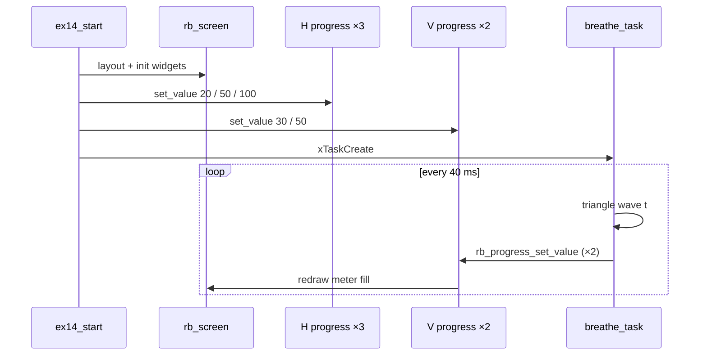

# Demo 14 — Progress bars

<div class="ebook-run">

**Track:** `demo-labs` · **Project:** `labs/demo-labs`

```text
rbdev run 14
```

<p class="ebook-source"><strong>Source:</strong> <code>labs/demo-labs/ex14-progress/README.md</code></p>

</div>


**Goal.** Explore **`rb_progress`** in both orientations: a **left column** of three **horizontal** “pill” bars at fixed demo values (**20**, **50**, **100**) to show static band coloring, and a **right column** of two **vertical** bars whose values **breathe** (triangle wave **0↔100**) so motion, orientation, and warn/danger bands are easy to see. Pure LCD — no robotos node, sensors, or host.

## Learning outcomes

1. Nest **`rb_layout`** containers: root **1×2**, inner **3×1** row stack for horizontals, **1×2** column for verticals.
2. Configure **`RB_PROGRESS_ORIENT_HORIZONTAL`** vs **`RB_PROGRESS_ORIENT_VERTICAL`**, ranges, labels, and **`rb_progress_set_show_value`**.
3. Apply **`rb_progress_set_bands`** with different thresholds on H vs V widgets and observe fill palette changes.
4. Animate UI from a FreeRTOS task with **`rb_progress_set_value`** only (no touch input in this demo).
5. Finish with **`rb_screen_set_root`** / **`rb_screen_reflow`** after the full widget tree is wired.

## Theory — deep detail

**Data path.** All values are **firmware-generated**. The three horizontal progress widgets are set once at startup from **`k_h_vals[]`** and never change — they exist so you can compare **low / mid / max** fill against the same band edges (**warn @ 50**, **danger @ 90**). The two vertical widgets are updated every **40 ms** in **`breathe_task`**: a shared counter **`t`** drives a piecewise linear “triangle” so each bar sweeps **0→100→0**, with the second bar phase-shifted by **50** ticks for visual separation.

**Widget modes.** Progress widgets are display-only meters: there is no **`RB_PROGRESS_MODE_INPUT`** pairing in this file. Style tokens differentiate columns: horizontals use **`RB_STYLE_SUCCESS`**; vertical **Bat** uses **`RB_STYLE_INFO`**, **CPU** uses **`RB_STYLE_PRIMARY`**. Vertical bands are **70 / 90** (stricter than the horizontal **50 / 90**), so the same numeric value can look “calmer” on the left column than on the right.

**Sensor / sim fallbacks.** Not applicable — no **`bsp_*`** sensor calls. Any **ws28p** or **es3c28p** board with a working display shows identical behavior.

**Publish semantics.** Not applicable — no **`rb_node`**, **`rb_publish`**, or wire traffic.

**Touch.** Not used; **`ex14_start`** does not create a touch task. Animation is entirely from **`breathe_task`**.

## Architecture

```
┌────────────────────── app_main ──────────────────────┐
│  bsp_init()  →  ex14_start()                         │
└──────────────────────────┬───────────────────────────┘
                           │
         ┌─────────────────▼─────────────────┐
         │  rb_display_open / rb_screen      │
         │  rb_layout root (1 row, 2 cols)   │
         │    ├─ g_hcol (3 rows)             │
         │    │    Load  H progress  = 20    │
         │    │    Temp  H progress  = 50    │
         │    │    Fan   H progress  = 100   │
         │    └─ g_vcol (2 cols)             │
         │         Bat V progress (breathe)  │
         │         CPU V progress (breathe)  │
         └─────────────────┬─────────────────┘
                           │
         ┌─────────────────▼─────────────────┐
         │  breathe_task @ 40 ms           │
         │  rb_progress_set_value (V only) │
         └─────────────────────────────────┘
```

## Sequence



## APIs this demo uses

| Layer | You will call |
|-------|----------------|
| Board | `bsp_init` (display/touch stack from BSP) |
| UI tree | `rb_display_open`, `rb_screen_init`, `rb_layout_init`, `rb_layout_add`, `rb_screen_set_root`, `rb_screen_reflow` |
| Progress | `rb_progress_init`, `rb_progress_set_orient`, `rb_progress_set_range`, `rb_progress_set_bands`, `rb_progress_set_label`, `rb_progress_set_value`, `rb_progress_set_show_value` |
| Style | `RB_STYLE_SUCCESS`, `RB_STYLE_INFO`, `RB_STYLE_PRIMARY` |
| RTOS | `xTaskCreate`, `vTaskDelay` |

See [NAMING.md](../../NAMING.md).

## Prerequisites

- ESP-IDF **esp32s3**, **`librobotos_fw.a`**, board profile **ws28p** or **es3c28p**
- Comfortable with [Demo 06 — Sliders](../ex06-slider/README.md) layout nesting (this demo adds **`rb_progress`**)

## Build / flash

```bash
cd labs/demo-labs
rbdev run 14
# Ternion: rbdev config --board es3c28p then rbdev run 14
```

## Success + checklist

- [ ] **Left:** three horizontal bars labeled **Load**, **Temp**, **Fan** with values **20**, **50**, **100** visible.
- [ ] **Load (20)** stays in the “low” band color; **Temp (50)** crosses the first band edge (**50**); **Fan (100)** shows max fill and danger band styling.
- [ ] **Right:** **Bat** and **CPU** vertical bars oscillate smoothly **0↔100** out of phase.
- [ ] Vertical bars change color as they cross **70** and **90**.
- [ ] No serial host or bridge required.

## device-labs-style enable

In `labs/demo-labs/main/main.c`:

1. `#include "ex14.h"`
2. `ex14_start();`

Or: `rbdev run 14` from `labs/demo-labs` (rewrites `main/main.c`). Run `rbdev reconfigure` if you just added this folder.

## Previous / Next

- **Previous:** [Demo 13 — Topics + UI](../ex13-topics-ui/README.md)
- **Next:** [Demo 15 — Chart](../ex15-chart/README.md)
