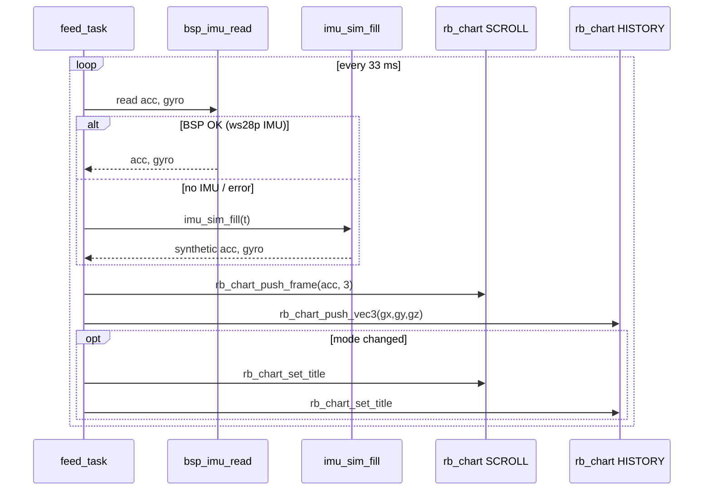

# Demo 15 — Live IMU charts

<div class="ebook-run">

**Track:** `demo-labs` · **Project:** `labs/demo-labs`

```text
rbdev run 15
```

<p class="ebook-source"><strong>Source:</strong> <code>labs/demo-labs/ex15-chart/README.md</code></p>

</div>


**Goal.** Feed real (or simulated) **6-axis IMU** samples into **two independent `rb_chart` panes** on one screen: **accelerometer** traces in **`RB_CHART_MODE_SCROLL`** (rolling window) and **gyroscope** traces in **`RB_CHART_MODE_HISTORY`** (fixed-capacity ring buffer drawn left-to-right). Learn how mode, range, and channel labels change the same widget for different physical units.

## Learning outcomes

1. Call **`bsp_imu_read(acc, gyro)`** at ~**30 Hz** and branch to **`imu_sim_fill`** when the BSP returns non-zero (no hardware IMU).
2. Configure **`RB_CHART_MODE_SCROLL`** vs **`RB_CHART_MODE_HISTORY`**, including external history storage with **`rb_chart_set_history(buf, HIST_CAP)`** where **`HIST_CAP`** is **320** (≥ typical plot width).
3. Push samples with **`rb_chart_push_frame`** (3-channel accel) and **`rb_chart_push_vec3`** (gyro convenience).
4. Set per-channel labels (**ax…az**, **gx…gz**), Y ranges (**±20 m/s²**, **±5 rad/s**), grid, and zero line.
5. Update chart **titles** when switching between real IMU and sim so bench behavior is obvious on glass.

## Theory — deep detail

**Data path.** A single **`feed_task`** loop ( **`vTaskDelay(33 ms)`** ≈ **30 Hz** ) reads **`float acc[3]`** and **`float gyro[3]`**. Success is defined as **`bsp_imu_read(...) == 0`**. On failure, **`imu_sim_fill(acc, gyro, t, &rng)`** advances a synthetic timeline **`t`** by **`SAMPLE_DT_S` (0.033 s)** using a deterministic LCG **`rng`**. Each iteration pushes one sample into **both** charts regardless of source.

**Widget modes — SCROLL (accel pane).** **`RB_CHART_MODE_SCROLL`** keeps a moving window: new samples enter at the “live” edge and older pixels shift off. There is **no** separate **`g_acc_hist`** array in this demo — the chart owns its internal buffer sized for the pane width. Range **−20…+20 m/s²** is chosen to show roughly **±2 g** transients plus **~+9.8 m/s²** gravity on **az** when the board lies flat on the table.

**Widget modes — HISTORY (gyro pane).** **`RB_CHART_MODE_HISTORY`** uses caller-supplied storage **`g_gyro_hist[HIST_CAP * 3]`** (interleaved or channel-major per widget implementation — here **3 channels**, capacity **320**). The plot fills **left → right** across the pixel width; when full, the buffer **shifts** and new data appends at the right edge. Range **−5…+5 rad/s** suits desk-scale rotation; spin the board faster if traces clip.

**Sensor / sim fallbacks.** **`bsp_imu_read`** is implemented on **ws28p** (QMI8658 on I²C). **es3c28p** does **not** advertise **`BOARD_CAP_IMU`** — reads fail and **`imu_sim_fill`** runs continuously. Titles become **`Accel SCROLL (sim)`** / **`Gyro HISTORY (sim)`** when **`real`** toggles; the transition is detected with **`was_real`** so titles update once per mode change.

**Publish semantics.** Not used — UI-only demo. No host required.

**Layout.** Root **`RB_LAYOUT_ROWS`**, **2** rows, **1** column, gutter **6**: accel chart on top, gyro on bottom. **`rb_screen_reflow`** distributes vertical space evenly after **`rb_screen_set_root`**.

## Architecture

```
┌────────────────────── app_main ──────────────────────┐
│  bsp_init()  →  ex15_start()                         │
└──────────────────────────┬───────────────────────────┘
                           │
         ┌─────────────────▼─────────────────┐
         │  rb_screen + 2-row layout         │
         │    g_acc  SCROLL  3ch  m/s²       │
         │    g_gyro HISTORY 3ch  rad/s      │
         │         g_gyro_hist[320×3]        │
         └─────────────────┬─────────────────┘
                           │
         ┌─────────────────▼─────────────────┐
         │  feed_task @ ~30 Hz               │
         │    bsp_imu_read ──ok──┐           │
         │         fail          │           │
         │         imu_sim_fill ◀┘           │
         │    push_frame(acc) push_vec3(gyro)│
         │    title "(sim)" if synthetic     │
         └─────────────────────────────────┘
```

## Sequence



## APIs this demo uses

| Layer | You will call |
|-------|----------------|
| Board | `bsp_init`, `bsp_imu_read` |
| Sim | `imu_sim_fill` ([../../../ports/imu_sim.h](../../../ports/imu_sim.h)) |
| UI tree | `rb_display_open`, `rb_screen_init`, `rb_layout_init`, `rb_layout_add`, `rb_screen_set_root`, `rb_screen_reflow` |
| Chart | `rb_chart_init`, `rb_chart_set_mode`, `rb_chart_set_channels`, `rb_chart_set_range`, `rb_chart_set_history`, `rb_chart_set_title`, `rb_chart_set_channel_label`, `rb_chart_push_frame`, `rb_chart_push_vec3` |
| RTOS | `xTaskCreate`, `vTaskDelay` |

See [NAMING.md](../../NAMING.md).

## Prerequisites

- **ws28p** recommended for **real QMI8658** traces ([../../../ports/boards/ws28p/](../../../ports/boards/ws28p/))
- **es3c28p** runs fully on **`imu_sim`** — still valid for learning chart modes
- [Demo 14 — Progress](../ex14-progress/README.md) (RTOS animation task pattern)

## Build / flash

```bash
cd labs/demo-labs
rbdev run 15
# Real IMU: default ws28p
# Sim only:  rbdev config --board es3c28p then rbdev run 15
```

## Success + checklist

- [ ] Top pane title **Accel SCROLL** (or **`(sim)`** on es3c28p); bottom **Gyro HISTORY**.
- [ ] Three colored traces per pane with labels **ax, ay, az** and **gx, gy, gz**.
- [ ] **ws28p**, board flat: **az** near **+9.8 m/s²**; tilt moves **ax** / **ay**; twist adds gyro spikes.
- [ ] **SCROLL** pane shows a moving window; **HISTORY** pane fills horizontally then scrolls.
- [ ] **es3c28p**: smooth synthetic motion without moving the board.
- [ ] No host bridge required.

## device-labs-style enable

In `labs/demo-labs/main/main.c`:

1. `#include "ex15.h"`
2. `ex15_start();`

Or: `rbdev run 15` from `labs/demo-labs` (rewrites `main/main.c`). Run `rbdev reconfigure` if you just added this folder.

## Previous / Next

- **Previous:** [Demo 14 — Progress](../ex14-progress/README.md)
- **Next:** [Demo 16 — IMU viz](../ex16-imu-viz/README.md)
