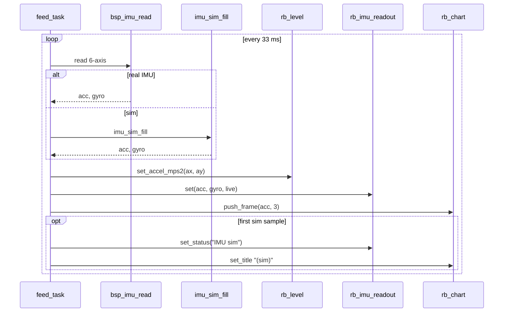

# Demo 16 — IMU visualization

<div class="ebook-run">

**Track:** `demo-labs` · **Project:** `labs/demo-labs`

```text
rbdev run 16
```

<p class="ebook-source"><strong>Source:</strong> <code>labs/demo-labs/ex16-imu-viz/README.md</code></p>

</div>


**Goal.** Build a **dashboard-style IMU view** that combines three widget types fed from one **`feed_task`**: a **spirit-level bubble** (`rb_level`) driven by horizontal acceleration, a **numeric readout** with bipolar accel bars and gyro text (`rb_imu_readout`), and a **bottom HISTORY chart** of all three accel axes. Same **`bsp_imu_read` / `imu_sim_fill`** fallback as Demo 15, but oriented toward human interpretation rather than raw traces alone.

## Learning outcomes

1. Map **`acc[0]` / `acc[1]`** (m/s²) into **`rb_level_set_accel_mps2`** for tilt visualization; enable live ball rendering with **`rb_level_set_live`**.
2. Push full **6-axis** state into **`rb_imu_readout_set(readout, acc, gyro, live_flag)`** and surface sim mode via **`rb_imu_readout_set_status`**.
3. Reuse **`RB_CHART_MODE_HISTORY`** with **`g_acc_hist[HIST_CAP * 3]`** (**HIST_CAP = 320**) for long-run accel logging on screen.
4. Nest layouts: top row **1×2** (**level** | **readout**), bottom row full-width chart (**`RB_LAYOUT_ROWS`**, 2 rows).
5. Detect IMU vs sim once per transition and update titles/status strings without spamming every frame.

## Theory — deep detail

**Data path.** Every **~33 ms**, **`feed_task`** obtains **`acc[3]`** and **`gyro[3]`** either from **`bsp_imu_read`** or **`imu_sim_fill`**. The same sample tuple fans out to three consumers:

1. **`rb_level_set_accel_mps2(&g_level, acc[0], acc[1])`** — only the horizontal plane; gravity on **az** does not move the bubble directly. Tilting the board shifts the green ball toward the downhill direction in the widget’s circle.
2. **`rb_imu_readout_set(&g_readout, acc, gyro, real ? 1 : 0)`** — numeric/bipolar bars for all accel axes plus gyro rates; the **`live_flag`** tells the widget whether data is hardware-backed.
3. **`rb_chart_push_frame(&g_acc, acc, 3)`** — HISTORY pane **ax, ay, az** over time.

**Widget modes.** **`rb_level`** runs in “live” mode (**`rb_level_set_live(1)`**) for both real and sim data so the ball animates whenever **`acc[0/1]`** change. **`rb_imu_readout`** is display-only. **`rb_chart`** uses **`RB_CHART_MODE_HISTORY`** with range **−20…+20 m/s²**, grid and zero line enabled — same physical scaling as Demo 15’s accel pane but different presentation mode.

**Sensor / sim fallbacks.** **ws28p** provides **`BOARD_CAP_IMU`** and live QMI8658 samples. **es3c28p** lacks IMU capability; **`bsp_imu_read`** fails and **`imu_sim_fill`** produces phase-offset sines with **az** biased near **+g**. On sim, **`rb_imu_readout_set_status(&g_readout, "IMU sim")`** appears; chart title becomes **`Accel HISTORY (sim)`**. **`rb_level_set_live(1)`** is set when mode is known — sim still drives a visible orbiting bubble from synthetic **ax/ay**.

**Publish semantics.** None — local LCD only.

**Comparison to Demo 15.** Demo 15 splits **SCROLL accel** vs **HISTORY gyro**. Demo 16 keeps **gyro on the readout widget** and uses **HISTORY for accel only**, matching a “vehicle dashboard” layout (level + digits + trend).

## Architecture

```
┌────────────────────── app_main ──────────────────────┐
│  bsp_init()  →  ex16_start()                         │
└──────────────────────────┬───────────────────────────┘
                           │
         ┌─────────────────▼─────────────────┐
         │  rb_screen                        │
         │  row0: top layout (1×2)           │
         │    ├─ rb_level      (ax, ay)      │
         │    └─ rb_imu_readout (6-axis)     │
         │  row1: rb_chart HISTORY accel     │
         │         g_acc_hist[320×3]         │
         └─────────────────┬─────────────────┘
                           │
         ┌─────────────────▼─────────────────┐
         │  feed_task @ ~30 Hz               │
         │    bsp_imu_read | imu_sim_fill    │
         │    → level, readout, chart        │
         │    status "IMU sim" if synthetic  │
         └─────────────────────────────────┘
```

## Sequence



## APIs this demo uses

| Layer | You will call |
|-------|----------------|
| Board | `bsp_init`, `bsp_imu_read` |
| Sim | `imu_sim_fill` |
| UI tree | `rb_display_open`, `rb_screen_init`, `rb_layout_init`, `rb_layout_add`, `rb_screen_set_root`, `rb_screen_reflow` |
| Level | `rb_level_init`, `rb_level_set_live`, `rb_level_set_accel_mps2` |
| Readout | `rb_imu_readout_init`, `rb_imu_readout_set`, `rb_imu_readout_set_status` |
| Chart | `rb_chart_init`, `rb_chart_set_mode`, `rb_chart_set_history`, `rb_chart_push_frame`, … |
| RTOS | `xTaskCreate`, `vTaskDelay` |

See [NAMING.md](../../NAMING.md).

## Prerequisites

- **ws28p** for physical tilt/gyro behavior (**QMI8658** on [../../../ports/boards/ws28p/](../../../ports/boards/ws28p/))
- **es3c28p** acceptable with **`imu_sim`** (status line + orbiting bubble)
- Completed [Demo 15 — Chart](../ex15-chart/README.md) (IMU read loop + HISTORY buffer sizing)

## Build / flash

```bash
cd labs/demo-labs
rbdev run 16
# Ternion sim path: rbdev config --board es3c28p then rbdev run 16
```

## Success + checklist

- [ ] Top-left bubble centers when board is flat on **ws28p**; tilting moves ball toward low side.
- [ ] Top-right readout shows accel bars and gyro numbers updating smoothly.
- [ ] Bottom **Accel HISTORY** draws three traces; fills left-to-right then shifts.
- [ ] Flat board: **az** ≈ **+9.8 m/s²** on readout/chart; **ax/ay** near zero.
- [ ] **es3c28p**: **`IMU sim`** status and **`(sim)`** chart title; motion without hardware.
- [ ] No host bridge required.

## device-labs-style enable

In `labs/demo-labs/main/main.c`:

1. `#include "ex16.h"`
2. `ex16_start();`

Or: `rbdev run 16` from `labs/demo-labs` (rewrites `main/main.c`). Run `rbdev reconfigure` if you just added this folder.

## Previous / Next

- **Previous:** [Demo 15 — Chart](../ex15-chart/README.md)
- **Next:** [Demo 17 — Mic viz](../ex17-mic-viz/README.md)
