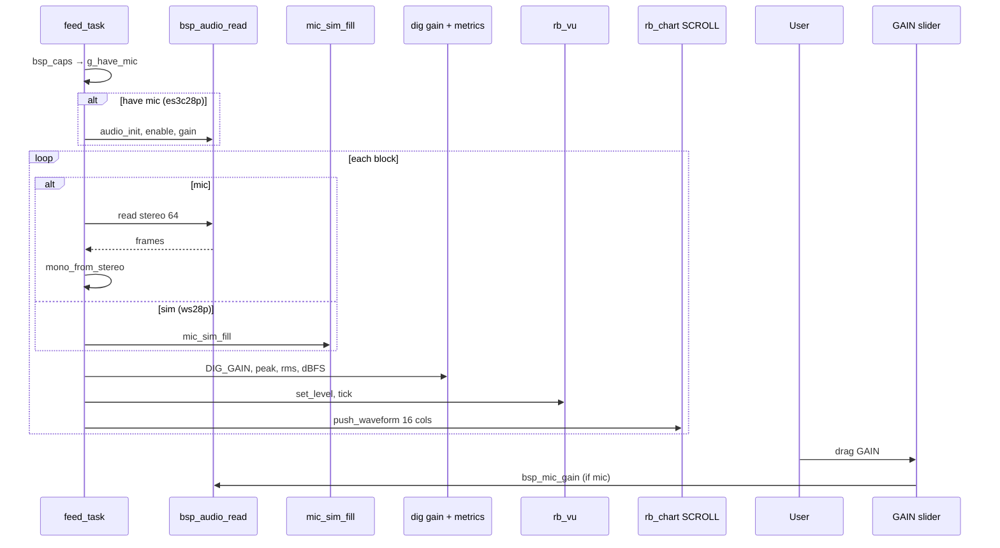

# Demo 17 — Realtime mic dashboard

<div class="ebook-run">

**Track:** `demo-labs` · **Project:** `labs/demo-labs`

```text
rbdev run 17
```

<p class="ebook-source"><strong>Source:</strong> <code>labs/demo-labs/ex17-mic-viz/README.md</code></p>

</div>


**Goal.** Assemble a **microphone monitoring dashboard** on the LCD: **VU meter** in **dBFS**, numeric **peak dBFS** and **PCM** readouts, a **SCROLL waveform** plot, and a vertical **GAIN** slider that drives hardware PGA when a mic is present. When **`BOARD_CAP_MIC`** is absent, **`mic_sim_fill`** substitutes synthetic PCM so the same UI runs on **ws28p** (no mic cap) and **es3c28p** (real ES8311 path).

## Learning outcomes

1. Probe capabilities with **`bsp_caps() & BOARD_CAP_MIC`**, then **`bsp_audio_init`**, **`bsp_mic_enable`**, **`bsp_mic_gain`**, **`bsp_audio_read`** — or fall back to **`mic_sim_fill`** with real-time pacing.
2. Configure **`rb_vu`** for **`RB_VU_SCALE_DBFS`**, segment/zones, peak hold/decay, and clip indication when post-gain peak ≥ **30000**.
3. Downmix stereo I2S to mono (max-abs channel per frame), apply fixed **`DIG_GAIN`**, compute **peak/RMS/dBFS**, and drive **`rb_vu_set_level(rms, peak)`**.
4. Push **display AGC**-scaled waveform columns into **`RB_CHART_MODE_SCROLL`** (**16** columns per **64**-sample block) so normal speech fills **±1** plot range.
5. Place widgets with **manual geometry** (`place_dashboard`) when a weighted split (~**80%** / **20%**) is easier than nested **`rb_layout`**.

## Theory — deep detail

**Data path (capture → metrics → UI).** **`feed_task`** loops forever:

1. **Capture** up to **`BLOCK_FRAMES` (64)** mono samples per inner block, **`BLOCKS_PER_TICK` = 1**, at **`FS_HZ` = 16000**. Real path: **`bsp_audio_read(stereo, BLOCK_FRAMES)`** → **`mono_from_stereo`** (pick **L** or **R** by larger absolute sample per frame). Sim path: **`mic_sim_fill(mono, BLOCK_FRAMES, t, rng)`** then advance **`t`** by **`BLOCK_FRAMES / MIC_SIM_FS_HZ`**.
2. **Gain staging** — see table below. **`apply_dig_gain`** multiplies every sample by **`DIG_GAIN` (4)** with **int16** saturation before metrics/plot.
3. **Metrics** — **`raw_peak_of`**, **`raw_rms_of`**, **`peak_to_dbfs`** maps peak to **−60…0 dBFS** (**`DBFS_FLOOR = −60`**, reference full scale **32767**). Labels update only on change (**`set_label_if_changed`**) to reduce flicker.
4. **VU** — **`rb_vu_set_level(rms, peak)`**, clip flag, **`rb_vu_tick`** for decay/hold (**hold 80 ms**, **decay 25 ms**).
5. **Plot** — **`push_waveform`** divides the block into **`COLS_PER_TICK` (16)** segments, takes signed peak per segment, divides by **`g_plot_env`** (smoothed block peak envelope) so quiet speech still uses most of the chart height.

**Widget modes.** **VU** is display + internal animation tick. **GAIN** slider is **`RB_SLIDER_MODE_INPUT`** vertical **0…100**, default **`GAIN_DEFAULT` (45)**; **`on_gain`** sets **`bsp_mic_gain`** only when **`g_have_mic`**. **Chart** is **`RB_CHART_MODE_SCROLL`**, **1** channel **"pcm"**, range **−1…+1**, grid + zero line.

**Sensor / sim fallbacks.** At startup, **`g_have_mic = (bsp_caps() & BOARD_CAP_MIC) != 0`**. **es3c28p** advertises **`BOARD_CAP_MIC`**; init/enable/gain/mute run on success. **ws28p** caps are IMU/RTC/battery/button **without** mic — **`g_have_mic`** is false and **`mic_sim_fill`** runs. Titles/labels switch to **`PLOT (sim)`** and **`VU sim`**. Sim path calls **`pace_after_capture`** so block timing matches **~4 ms** real-time at 16 kHz instead of running flat-out.

**Publish semantics.** None — standalone audio UI lab.

**Empty capture.** If **`bsp_audio_read`** returns **0**, the task zeros VU, sets readouts to **−60 dBFS** / **PCM 0**, pushes **16** zero columns, delays **4 ms**, and retries.

**Gain stages (do not max all at once).**

| Stage | Where | Default in this demo |
|-------|--------|----------------------|
| ADC digital | codec register via **`bsp_mic_mute(0)`** / unmute path | **0 dB** (driver default) |
| PGA analog | **GAIN** slider → **`bsp_mic_gain(0…100)`** → device **~0…+42 dB** scale | **45%** (~**+18 dB**) |
| Soft digital | **`DIG_GAIN`** constant in **`ex17.c`** | **×4** after mono merge |

Tuning guide: silence should sit **~0–5%** VU height; conversational speech **~30–60%**; loud input may clip (**VU clip** indicator near **PCM ≥ 30000**). Adjust **GAIN** on glass first; raise **`DIG_GAIN`** in source only if the slider tops out still too quiet.

**Layout geometry.** **`place_dashboard`** computes **`gain_w`** ≈ **W/5** clamped **[52, 72]**, left stack width **`left_w = W - gap - gain_w`**. Top half split: **VU** height + **READOUT_H (20)** row for dBFS/PCM labels; remainder to **SCROLL** plot. Right column: full-height **GAIN** slider. **`touch_task`** @ **16 ms** feeds **`rb_slider_feed_touch`** on gain only.

## Architecture

```
┌────────────────────── app_main ──────────────────────┐
│  bsp_init()  →  ex17_start()                         │
└──────────────────────────┬───────────────────────────┘
                           │
         ┌─────────────────▼─────────────────┐
         │  place_dashboard (manual rects)   │
         │  ┌──────────────────┬──────────┐  │
         │  │ rb_vu  dBFS      │ rb_slider│  │
         │  │ labels dBFS/PCM  │  GAIN    │  │
         │  ├──────────────────┤ vertical │  │
         │  │ rb_chart SCROLL  │          │  │
         │  └──────────────────┴──────────┘  │
         └─────────────────┬─────────────────┘
                           │
      ┌────────────────────┴────────────────────┐
      │                                         │
┌─────▼──────┐                          ┌───────▼──────┐
│ feed_task  │                          │ touch_task   │
│ cap mic/sim│                          │ gain slider  │
│ dig gain   │                          │ touch        │
│ VU + plot  │                          └──────────────┘
└────────────┘
```

## Sequence



## APIs this demo uses

| Layer | You will call |
|-------|----------------|
| Board | `bsp_init`, `bsp_caps`, `bsp_audio_init`, `bsp_audio_read`, `bsp_mic_enable`, `bsp_mic_gain`, `bsp_mic_mute`, `bsp_touch_read` |
| Sim | `mic_sim_fill`, `MIC_SIM_FS_HZ` |
| VU | `rb_vu_init`, `rb_vu_set_scale`, `rb_vu_set_db_range`, `rb_vu_set_level`, `rb_vu_set_clipped`, `rb_vu_tick`, `rb_vu_apply_geometry`, … |
| Chart | `rb_chart_init`, `rb_chart_set_mode`, `rb_chart_push_frame`, `rb_chart_apply_geometry`, … |
| Slider / labels | `rb_slider_*`, `rb_label_*`, `rb_slider_feed_touch` |
| RTOS | `xTaskCreate`, `vTaskDelay` |
| libm | `log10f`, `sqrtf` (dBFS + RMS) |

See [NAMING.md](../../NAMING.md).

## Prerequisites

- **es3c28p** for **live microphone** and **GAIN → PGA** (**ES8311** path)
- **ws28p** runs **`mic_sim`** automatically (no **`BOARD_CAP_MIC`**) — still validates VU/plot/slider
- [Demo 13 — Topics + UI](../ex13-topics-ui/README.md) (vertical slider + touch task) helps with **GAIN** interaction

## Build / flash

```bash
cd labs/demo-labs
rbdev run 17
# Live mic: rbdev config --board es3c28p then rbdev run 17
# Sim UI:  default ws28p (no hardware mic)
```

Optional: `rbdev flash --board es3c28p` after config when switching from ws28p.

## Success + checklist

- [ ] Layout matches wireframe: **VU + readouts + plot** left, **GAIN** full height right.
- [ ] **es3c28p**: speak/clap — VU segments and **SCROLL** trace respond in near real time (~**4 ms**/block).
- [ ] Drag **GAIN** — loudness changes on hardware mic; label shows **0…100** value.
- [ ] **dBFS** and **PCM** labels update (PCM is **peak after `DIG_GAIN`**).
- [ ] Very loud input triggers **clip** styling on VU (**peak ≥ 30000**).
- [ ] **ws28p**: **VU sim** / **`PLOT (sim)`**; synthetic tone still animates meter and strip.
- [ ] No host serial bridge required.

## device-labs-style enable

In `labs/demo-labs/main/main.c`:

1. `#include "ex17.h"`
2. `ex17_start();`

Or: `rbdev run 17` from `labs/demo-labs` (rewrites `main/main.c`). Run `rbdev reconfigure` if you just added this folder.

## Previous / Next

- **Previous:** [Demo 16 — IMU viz](../ex16-imu-viz/README.md)
