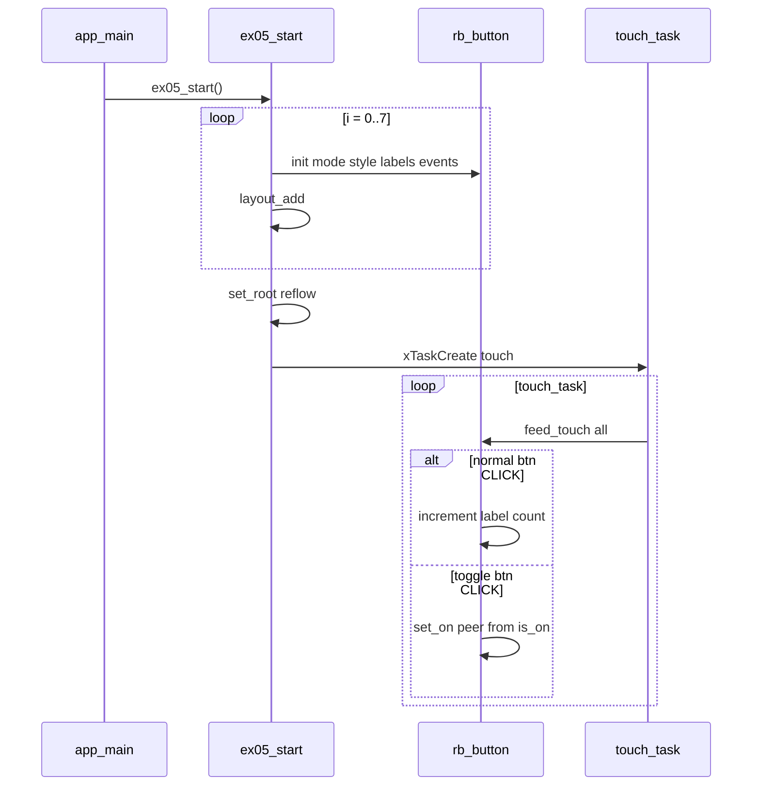

# Demo 05 — Buttons, styles, and toggle pairs

**Goal.** Present eight `rb_button` widgets in a **2×4** grid: the top row demonstrates **normal** buttons with semantic `RB_STYLE_*` themes and click counting; the bottom row demonstrates **toggle** buttons with ON/OFF captions, bottom indicators, and mirrored pairs—all driven by the same touch-polling pattern as Demo 04.

## Learning outcomes

1. Switch between **`RB_BUTTON_MODE_NORMAL`** and **`RB_BUTTON_MODE_TOGGLE`** and observe different event semantics.
2. Handle **`RB_BUTTON_EV_DOWN`**, **`UP`**, and **`CLICK`** in a callback (border width feedback on press/release for normal buttons).
3. Apply shared semantic styles via `rb_button_set_style` (`PRIMARY` … `LIGHT`).
4. Configure toggle chrome: dual labels, indicator width/thickness, initial ON state.
5. Mirror toggle state across column pairs using `CLICK` handlers and `rb_button_set_on` / `rb_button_is_on` without recursive events.

## Theory — deep detail

### What `rb_button` is

A flat **button leaf** with two modes:

- **Normal** — momentary: fires DOWN when the finger enters pressed, UP when released, CLICK when lift happens over the widget after DOWN. Toggle state is unused; label text is a single string (`rb_button_set_label`).
- **Toggle** — CLICK flips internal `on` and swaps ON/OFF label text; optional **indicator bar** (width % and thickness px) shows state.

Events fire for **user touch only** (via `rb_button_feed_touch`), not when the app calls `rb_button_set_on`.

Event order documented in the header: DOWN → UP on release; CLICK on successful tap. Toggle mode flips on CLICK.

### UI tree model (screen → layout → leaf)

`rb_layout_init(..., RB_LAYOUT_GRID, **2**, **4**, gap **4**)` → eight buttons.

Indices **0–3** (first row):

- Mode normal, labels `PRI`, `SEC`, `OK`, `WARN` from `k_labels[]`
- Styles `RB_STYLE_PRIMARY`, `SECONDARY`, `SUCCESS`, `WARNING`
- `on_normal_event` tracks presses in `g_presses[i]`; on CLICK replaces label with decimal count
- DOWN sets border width 3; UP restores border width 1

Indices **4–7** (second row):

- Mode toggle, labels `"ON"` / `"OFF"`, indicator **80%** width, **2** px thick
- Initial ON: even indices on, odd off (`(i & 1) == 0`)
- Styles `DANGER`, `INFO`, `DARK`, `LIGHT` respectively
- Pairs: 4↔5 and 6↔7 — `on_toggle_event` on CLICK copies `rb_button_is_on(btn)` to peer via `rb_button_set_on`

All eight added with `rb_layout_add`, then root + reflow.

### FreeRTOS role

Single **`touch_task`**: every 20 ms read touch, `rb_button_feed_touch` on all eight buttons. Same architecture as Demo 04.

No background animators; `ex05_start` idles with 1 s delays after spawning touch.

### Styles and API semantics

`rb_style_t` (`rb_style.h`) maps semantic names to face, border, and text RGB. `rb_button_set_style` is the primary theming entry point in this demo (contrasts with Demo 04 switches using defaults).

Important limits: `RB_BUTTON_LABEL_MAX` (8 chars including NUL) — short tags like `PRI` fit; longer strings truncate.

`rb_button_set_on_event(fn, user)` — callback invoked **outside** display lock; may call back into button APIs (as this demo does for borders and peer sync).

## Architecture

```
┌──────────────┐
│   app_main   │
└──────┬───────┘
       ▼
┌──────────────┐
│  ex05_start  │
└──────┬───────┘
       ▼
┌──────────────────────────────────────────────────────────────┐
│ rb_layout  GRID  2 rows × 4 cols  gap 4                      │
├────────┬────────┬────────┬────────┬───────────────────────────┤
│ btn 0  │ btn 1  │ btn 2  │ btn 3  │  NORMAL + RB_STYLE_*    │
│ PRI    │ SEC    │ OK     │ WARN   │  click → count label    │
├────────┼────────┼────────┼────────┼───────────────────────────┤
│ btn 4  │ btn 5  │ btn 6  │ btn 7  │  TOGGLE ON/OFF + ind.   │
│ pair ◄─┼─► pair │ pair ◄─┼─► pair │  CLICK sync peer        │
└────────┴────────┴────────┴────────┴───────────────────────────┘
                              ▲
                              │
                       touch_task (20 ms)
                       feed_touch × 8
```

## Sequence



## APIs this demo uses

| Layer | Calls |
|-------|--------|
| Board | `bsp_init`, `bsp_touch_read` |
| Display / screen | `rb_display_open`, `rb_screen_init`, `rb_screen_set_root`, `rb_screen_reflow` |
| Layout | `rb_layout_init` (`RB_LAYOUT_GRID`, 2×4, gap 4), `rb_layout_add` |
| Style | `RB_STYLE_*` via `rb_button_set_style` |
| Button | `rb_button_init`, `rb_button_set_mode`, `rb_button_set_label` / `set_labels`, `rb_button_set_indicator_size`, `rb_button_set_on`, `rb_button_is_on`, `rb_button_set_border_width`, `rb_button_set_on_event`, `rb_button_feed_touch` |
| FreeRTOS | `xTaskCreate`, `vTaskDelay`, `pdMS_TO_TICKS` |
| Your demo | `main/main.c` → `ex05_start` |

## Prerequisites

- ESP-IDF (**esp32s3**)
- **`librobotos_fw.a`** + headers ([lib/README.md](../../lib/README.md))
- Touch board **`ws28p`** or **`es3c28p`**

## Build / flash

```bash
cd labs/demo-labs
rbdev run 05
```

## Success + checklist

**Success:** Top row shows four styled short labels; each increments its numeric label when tapped. Bottom row toggles ON/OFF with indicator; columns 4–5 and 6–7 stay matched.

- [ ] Border thickens while finger is down on a normal button
- [ ] Click count appears on normal buttons after tap
- [ ] Toggle indicators reflect ON/OFF
- [ ] Paired toggles in the same column mirror state

## device-labs-style enable

In `labs/demo-labs/main/main.c`:

1. `#include "ex05.h"`
2. `ex05_start();` after `bsp_init()`.

Or: `rbdev run 05` from `labs/demo-labs`. Run `rbdev reconfigure` if needed.

---

**Previous:** [Demo 04 — Switch](../ex04-switch/README.md) · **Next:** [Demo 06 — Slider](../ex06-slider/README.md)
