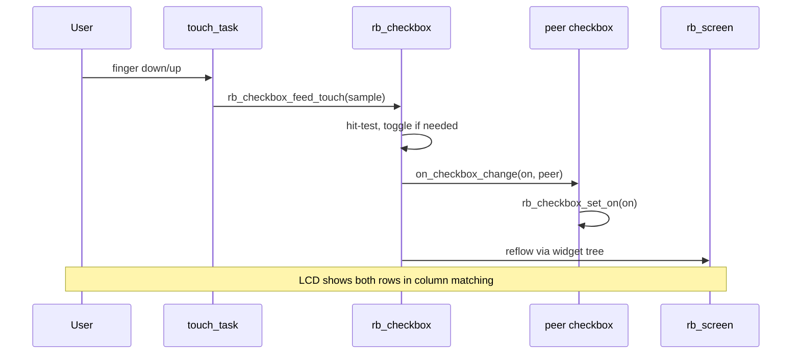

# Demo 07 — Checkbox grid with column peers

**Goal.** Build an **8-cell** (`2×4`) checkbox collage on the LCD: four semantic columns (**WiFi**, **BLE**, **Mute**, **Lock**) each tinted with a different `RB_STYLE_*`, and **vertical pairing** so the top and bottom cell in every column always share the same checked state. No robotos node or serial wire — touch and local callbacks only.

## Learning outcomes

1. Initialize many `rb_checkbox` widgets and place them in a **`RB_LAYOUT_GRID`** (`2` rows × `4` cols, gutter `4`).
2. Apply per-column **`rb_checkbox_set_style`** and **`rb_checkbox_set_label`** for a style catalog row.
3. Wire **`rb_checkbox_set_on_change`** so a tap on one row drives **`rb_checkbox_set_on`** on its column peer (mirror without duplicating hit logic).
4. Run a dedicated **touch task** that polls **`bsp_touch_read`** and forwards samples with **`rb_checkbox_feed_touch`** on every checkbox.

## Theory — deep detail

A **checkbox** is an independent boolean control: checked (“on”) or unchecked (“off”). Unlike a radio group, each checkbox could stand alone; this demo still **couples** cells vertically so you practice **application-level synchronization** — the widget library does not auto-link peers; your `on_checkbox_change` callback receives the peer pointer as `user` and copies the new state.

**Initial state.** For index `i` in the top row (`i < DEMO_COLS`), the firmware sets on when `(col & 1) == 0`, so columns **0** and **2** start checked (**WiFi**, **Mute**). After registering callbacks, the bottom row is explicitly aligned with **`rb_checkbox_set_on`** on each lower cell to match its upper partner.

**Styles.** Column `col` uses `k_styles[col]`: Primary, Success, Warning, Danger — the same four accent tokens used across the widget catalog so learners see color semantics on a real control, not only on labels.

**Touch path.** `ex07_start` returns into `app_main`’s idle delay loop, but a FreeRTOS **`touch_task`** (priority `5`, stack `3072`, period **20 ms**) keeps input responsive. Each successful **`bsp_touch_read`** fans the same sample to all eight **`rb_checkbox_feed_touch`** calls; the checkbox implementation decides which cell (if any) consumed the tap.

**What you are not doing yet.** There is no **`rb_node`**, no **`rb_log` on the wire**, and no host **`ParamCmd`**. State lives in RAM until you toggle it on glass.

## Architecture

```
┌────────────────────── app_main ──────────────────────┐
│  bsp_init()  →  ex07_start()                         │
└──────────────────────────┬───────────────────────────┘
                           │
         ┌─────────────────▼─────────────────┐
         │  rb_display_open                    │
         │  rb_screen_init                     │
         │  rb_layout_init (GRID 2×4)          │
         │    └─ 8 × rb_checkbox (styled)      │
         │         on_change → column peer     │
         │  rb_screen_set_root / reflow        │
         └─────────────────┬─────────────────┘
                           │
         ┌─────────────────▼─────────────────┐
         │  touch_task @ 20 ms                 │
         │  bsp_touch_read → feed_touch × 8    │
         └─────────────────────────────────────┘
```

## Sequence



## APIs this demo uses

| Layer | You will call |
|-------|----------------|
| Board | `bsp_init`, `bsp_touch_read` |
| UI tree | `rb_display_open`, `rb_screen_init`, `rb_layout_init`, `rb_layout_add`, `rb_screen_set_root`, `rb_screen_reflow` |
| Style | `RB_STYLE_PRIMARY`, `RB_STYLE_SUCCESS`, `RB_STYLE_WARNING`, `RB_STYLE_DANGER` (via `rb_checkbox_set_style`) |
| Checkbox | `rb_checkbox_init`, `rb_checkbox_set_label`, `rb_checkbox_set_on`, `rb_checkbox_is_on`, `rb_checkbox_set_on_change`, `rb_checkbox_feed_touch` |
| RTOS | `xTaskCreate`, `vTaskDelay` |

See [NAMING.md](../../NAMING.md) for the five-layer map (`rb` = robotos UI/runtime).

## Prerequisites

- ESP-IDF (same major as class notes), target **esp32s3**
- `lib/librobotos_fw.a` and headers under `include/firmware-esp32-s3-dev/` (see [../../lib/README.md](../../lib/README.md))
- Board profile **ws28p** (default) or **es3c28p** — [ports/boards/README.md](../../ports/boards/README.md)
- Completed [Demo 06 — Sliders](../ex06-slider/README.md) (layout + touch task pattern)

## Build / flash

```bash
cd labs/demo-labs
# GPIO_NUM_45 undeclared ⇒ wrong target (not S3).
rbdev run 07
# Ternion: rbdev config --board es3c28p then rbdev run 07
```

Optional: `rbdev run 07 --monitor` to attach the serial console after flash.

## Success + checklist

- [ ] LCD shows **2×4** checkboxes with labels **WiFi / BLE / Mute / Lock** repeated on both rows.
- [ ] Column colors match Primary / Success / Warning / Danger left to right.
- [ ] Top row: **WiFi** and **Mute** start checked; **BLE** and **Lock** start unchecked.
- [ ] Tapping either row in a column toggles **both** cells in that column together.
- [ ] No host serial-bridge required.

## device-labs-style enable

In `labs/demo-labs/main/main.c`:

1. `#include "ex07.h"`
2. `ex07_start();`

Or: `rbdev run 07` from `labs/demo-labs` (rewrites `main/main.c`). Run `rbdev reconfigure` if you just added this folder.

## Previous / Next

- **Previous:** [Demo 06 — Sliders](../ex06-slider/README.md)
- **Next:** [Demo 08 — Radio groups](../ex08-radio/README.md)
