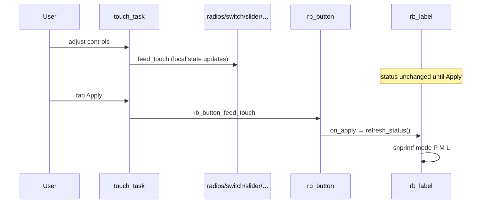

# Demo 09 — Composed settings form

**Goal.** Assemble a **single settings screen** from widgets you practiced in isolation: a **title**, a **3-way mode** radio group, **power switch**, **mute checkbox**, **level slider**, **Apply** button, and a **status line** that snapshots all values when you commit. This is the last **UI-only** lab before the serial wire in Demo 10.

## Learning outcomes

1. Compose **nested layouts** (`ROWS` root → `body` `COLS` → left/right `ROWS`, plus a `foot` row for slider + button).
2. Combine **`rb_radio_group`**, **`rb_switch`**, **`rb_checkbox`**, **`rb_slider`**, and **`rb_button`** on one screen.
3. Implement **explicit commit**: only **`RB_BUTTON_EV_CLICK`** on **Apply** calls **`refresh_status`** (widget changes alone do not update the status label).
4. Format a compact status string: mode name, power bit, mute bit, slider level.
5. Fan one touch sample to every interactive widget in **`touch_task`**.

## Theory — deep detail

**Form UX vs live binding.** Many tutorials bind a label to every widget’s `on_change` so the UI always reflects RAM. Product forms often **batch** edits: the user tries several controls, then presses **Save** or **Apply**. This demo teaches that pattern deliberately — **`refresh_status`** runs once at boot (after default radio select) and again only when **`on_apply`** sees **`RB_BUTTON_EV_CLICK`**. Until you tap **Apply**, the status line can be stale even though radios, switch, checkbox, and slider already moved on screen.

**Status format.** `refresh_status` reads the selected radio’s **`label`** string (fallback `"?"`), then prints:

```text
{mode} P{0|1} M{0|1} L{0…100}
```

where **`P`** is **`rb_switch_is_on(&g_pwr)`**, **`M`** is **`rb_checkbox_is_on(&g_mute)`**, and **`L`** is **`rb_slider_get_value(&g_level)`**. Initial text before first apply is **`tap Apply`** from setup; after **`ex09_start`** finishes wiring, **`refresh_status`** replaces it with live defaults (**Auto**, power **on**, mute **off**, level **40**).

**Widget defaults.**

| Control | Initial |
|---------|---------|
| Mode radio | **Auto** (`rb_radio_group_select` → `g_mode[0]`) |
| Power switch | ON (`rb_switch_set_on(..., 1)`), labels **ON** / **OFF** |
| Mute checkbox | unchecked |
| Level slider | horizontal, INPUT mode, range **0–100**, value **40**, label **Level**, value visible |

**Layout tree.**

- **`g_root`**: 4 rows — title, body, foot, status.
- **`g_body`**: 2 columns — left = mode stack, right = switch + mute.
- **`g_foot`**: slider + Apply side by side.

**Touch stack.** **`touch_task`** uses a **4096**-byte stack (larger than checkbox/radio demos) and feeds three radios, switch, checkbox, slider, and button each period.

## Architecture

```
┌────────────────────── app_main ──────────────────────┐
│  bsp_init()  →  ex09_start()                         │
└──────────────────────────┬───────────────────────────┘
                           │
         ┌─────────────────▼─────────────────┐
         │  g_root (ROWS)                    │
         │    g_title  "Settings"            │
         │    g_body (COLS)                  │
         │      g_left  → 3 × rb_radio       │
         │      g_right → switch + checkbox  │
         │    g_foot → slider + Apply btn    │
         │    g_status (label)               │
         └─────────────────┬─────────────────┘
                           │
         ┌─────────────────▼─────────────────┐
         │  touch_task @ 20 ms               │
         │  feed_touch: radio×3, switch,     │
         │    checkbox, slider, button       │
         └─────────────────────────────────────┘
```

## Sequence



## APIs this demo uses

| Layer | You will call |
|-------|----------------|
| Board | `bsp_init`, `bsp_touch_read` |
| UI tree | `rb_display_open`, `rb_screen_*`, `rb_layout_*` |
| Label | `rb_label_init`, `rb_label_set_style`, `rb_label_set_align`, `rb_label_set_text` |
| Radio | `rb_radio_*`, `rb_radio_group_*`, `rb_radio_feed_touch` |
| Switch | `rb_switch_init`, `rb_switch_set_style`, `rb_switch_set_labels`, `rb_switch_set_on`, `rb_switch_feed_touch` |
| Checkbox | `rb_checkbox_*`, `rb_checkbox_feed_touch` |
| Slider | `rb_slider_set_orient`, `rb_slider_set_mode`, `rb_slider_set_range`, `rb_slider_set_value`, `rb_slider_feed_touch` |
| Button | `rb_button_set_on_event`, `rb_button_feed_touch` |
| RTOS | `xTaskCreate`, `vTaskDelay` |

## Prerequisites

- [Demo 08 — Radio](../ex08-radio/README.md) and earlier widget labs (switch, checkbox, slider, button)
- Touch calibration working on your board (same as Demo 04–08)

## Build / flash

```bash
cd labs/demo-labs
rbdev run 09
# Ternion: rbdev config --board es3c28p then rbdev run 09
```

## Success + checklist

- [ ] Title **Settings** centered; footer status line visible.
- [ ] Boot status reads like **`Auto P1 M0 L40`** (mode/power/mute/level).
- [ ] Changing mode, power, mute, or slider **without** Apply leaves the status text unchanged.
- [ ] Tap **Apply** → status updates to match current controls.
- [ ] No robotos node or host serial-bridge required.

## device-labs-style enable

In `labs/demo-labs/main/main.c`:

1. `#include "ex09.h"`
2. `ex09_start();`

Or: `rbdev run 09` from `labs/demo-labs` (rewrites `main/main.c`). Run `rbdev reconfigure` if you just added this folder.

## Previous / Next

- **Previous:** [Demo 08 — Radio](../ex08-radio/README.md)
- **Next:** [Demo 10 — Log / wire](../ex10-log/README.md)
