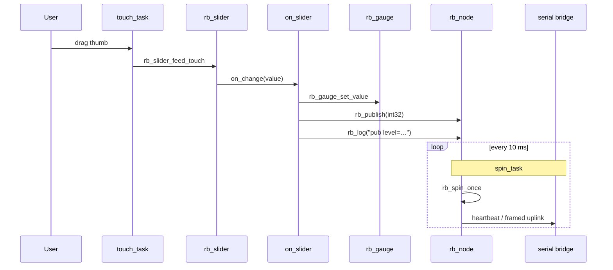

# Demo 13 — Topics + UI

**Goal.** Close the loop between **touch UI** and **robotos wire topics**: a vertical **INPUT** slider drives a horseshoe **DISPLAY** gauge on the LCD, and every value change **publishes** a framed uplink on the same message type used for IMU samples elsewhere in the workshop (`RSP_MSG_IMU`), with a compact **`int32`** payload. A background **spin** task keeps the serial transport, heartbeat, and command dispatch alive so a host bridge can decode traffic while you drag the thumb.

## Learning outcomes

1. Compose **`rb_slider`** (INPUT) and **`rb_gauge`** (DISPLAY) in one **`rb_layout`** row and keep them visually in sync from an **`on_change`** callback.
2. Initialize **`rb_node`** over **`rb_transport_serial`**, bind **`rb_cmd_bind_log`**, and call **`rb_spin_once`** + **`rb_cmd_poll`** from a dedicated task.
3. Register a publisher with **`rb_pub_init(..., RSP_MSG_IMU)`** and emit samples with **`rb_publish`** (payload size **`sizeof(int32)`**, not a full `ImuSample` struct — topic *style*, demo payload).
4. Use **gauge bands** (`rb_gauge_set_bands`) so fill color shifts at configurable warn/danger thresholds (here **70** / **90** on a **0…100** range).
5. Mirror the touch pattern from earlier UI labs: **`bsp_touch_read`** → **`rb_slider_feed_touch`** / **`rb_gauge_feed_touch`**.

## Theory — deep detail

**Data path (UI → wire).** Touch samples enter the slider; when the thumb moves, **`on_slider`** runs on the widget thread context of the change event. That handler (1) copies the value into the gauge with **`rb_gauge_set_value`**, (2) publishes the raw **`int32`** with **`rb_publish(&g_val_pub, &v, sizeof(v))`**, and (3) prints a human line with **`rb_log(&g_node, "pub level=%ld", ...)`**. The LCD update and the wire frame share one logical “level” integer — there is no separate sensor; the slider *is* the source of truth.

**Widget modes.** The slider is **`RB_SLIDER_MODE_INPUT`**: the user can drag it. The gauge is **`RB_GAUGE_MODE_DISPLAY`**: it reflects state only (no direct manipulation required for the demo, though **`rb_gauge_feed_touch`** is still fed for consistency with other labs). Both use **0…100** with **`%`** on the gauge; initial value **35**.

**Sensor / sim fallbacks.** This demo does **not** call **`bsp_imu_read`**. The **`RSP_MSG_IMU`** type is reused intentionally so host tools that already subscribe to IMU traffic can display your slider level without a new opcode — compare [Demo 10 — Log](../ex10-log/README.md), which publishes periodic IMU-sized ticks. On the board alone, the gauge and **`rb_log`** lines are enough to verify behavior.

**Publish semantics.** **`rb_publish`** accepts the payload if the transport queue accepts it (**`RB_OK`**); it does not guarantee delivery to a host (same contract as the desktop SDK). Nothing is published until the user moves the slider (no background ticker). Heartbeat is **1000 ms** on node name **`demo13`**. Without a host or serial bridge, frames still leave via USB-JTAG UART; decode them with the workshop serial-bridge tool as in Demo 10.

**Comms task.** **`spin_task`** (10 ms period) calls **`rb_spin_once`** (RX drain, heartbeat, subscriber dispatch) and **`rb_cmd_poll`** so inbound **`rb_cmd_*`** handlers stay responsive.

## Architecture

```
┌────────────────────── app_main ──────────────────────┐
│  bsp_init()  →  ex13_start()                         │
└──────────────────────────┬───────────────────────────┘
                           │
         ┌─────────────────▼─────────────────┐
         │  rb_display_open / rb_screen      │
         │  rb_layout (1 row, 2 cols)        │
         │    ├─ rb_slider INPUT  "Level"    │
         │    └─ rb_gauge DISPLAY "Out"      │
         │         bands @ 70 / 90           │
         └─────────────────┬─────────────────┘
                           │
         ┌─────────────────▼─────────────────┐
         │  rb_transport_serial + rb_node    │
         │    rb_pub → RSP_MSG_IMU (int32)   │
         │    rb_cmd_bind_log                │
         └─────────────────┬─────────────────┘
                           │
      ┌────────────────────┴────────────────────┐
      │                                         │
┌─────▼──────┐                          ┌───────▼──────┐
│ spin_task  │                          │ touch_task   │
│ spin_once  │                          │ touch_read   │
│ cmd_poll   │                          │ feed slider  │
│ @ 10 ms    │                          │ + gauge      │
└────────────┘                          └──────────────┘
```

## Sequence



## APIs this demo uses

| Layer | You will call |
|-------|----------------|
| Board | `bsp_init`, `bsp_touch_read` |
| UI tree | `rb_display_open`, `rb_screen_init`, `rb_layout_init`, `rb_layout_add`, `rb_screen_set_root`, `rb_screen_reflow` |
| Slider | `rb_slider_init`, `rb_slider_set_orient`, `rb_slider_set_mode`, `rb_slider_set_range`, `rb_slider_set_on_change`, `rb_slider_feed_touch` |
| Gauge | `rb_gauge_init`, `rb_gauge_set_mode`, `rb_gauge_set_bands`, `rb_gauge_set_value`, `rb_gauge_feed_touch` |
| Runtime / wire | `rb_transport_serial_init`, `rb_node_init`, `rb_pub_init`, `rb_publish`, `rb_log`, `rb_spin_once`, `rb_cmd_bind_log`, `rb_cmd_poll` |
| Protocol | `RSP_MSG_IMU` (payload = **`int32` level**, workshop convention) |
| RTOS | `xTaskCreate`, `vTaskDelay` |

See [NAMING.md](../../NAMING.md) for the five-layer map.

## Prerequisites

- ESP-IDF, target **esp32s3**, prebuilt **`librobotos_fw.a`** ([../../lib/README.md](../../lib/README.md))
- **ws28p** or **es3c28p** — touch works on both ([../../ports/boards/README.md](../../ports/boards/README.md))
- Completed [Demo 10 — Log](../ex10-log/README.md) (node + publish) and [Demo 11 — Gauges](../ex11-gauge/README.md) (gauge bands)
- **Host optional but recommended** for wire verification: serial-bridge or any COBS decoder expecting workshop framing

## Build / flash

```bash
cd labs/demo-labs
rbdev run 13
# Ternion: rbdev config --board es3c28p then rbdev run 13
```

Attach **`rbdev run 13 --monitor`** or `idf.py monitor` to see **`rb_log`** text; use the host bridge for clean **`RSP_MSG_IMU`** decode.

## Success + checklist

- [ ] Vertical **Level** slider and **Out** gauge sit side by side; both show **35** at boot.
- [ ] Dragging the slider moves the gauge arc and numeric readout together.
- [ ] Fill stays “success” below **70**, shifts warn tone from **70**, danger tone from **90** (band thresholds in code).
- [ ] Serial log shows **`pub level=N`** when the value changes.
- [ ] With a host bridge running, **`RSP_MSG_IMU`** frames appear with **4-byte** little-endian **`int32`** payload matching the slider.
- [ ] Heartbeat / spin task keeps running (no UI freeze after several minutes).

## device-labs-style enable

In `labs/demo-labs/main/main.c`:

1. `#include "ex13.h"`
2. `ex13_start();`

Or: `rbdev run 13` from `labs/demo-labs` (rewrites `main/main.c`). Run `rbdev reconfigure` if you just added this folder.

## Previous / Next

- **Previous:** [Demo 12 — Params](../ex12-param/README.md)
- **Next:** [Demo 14 — Progress](../ex14-progress/README.md)
